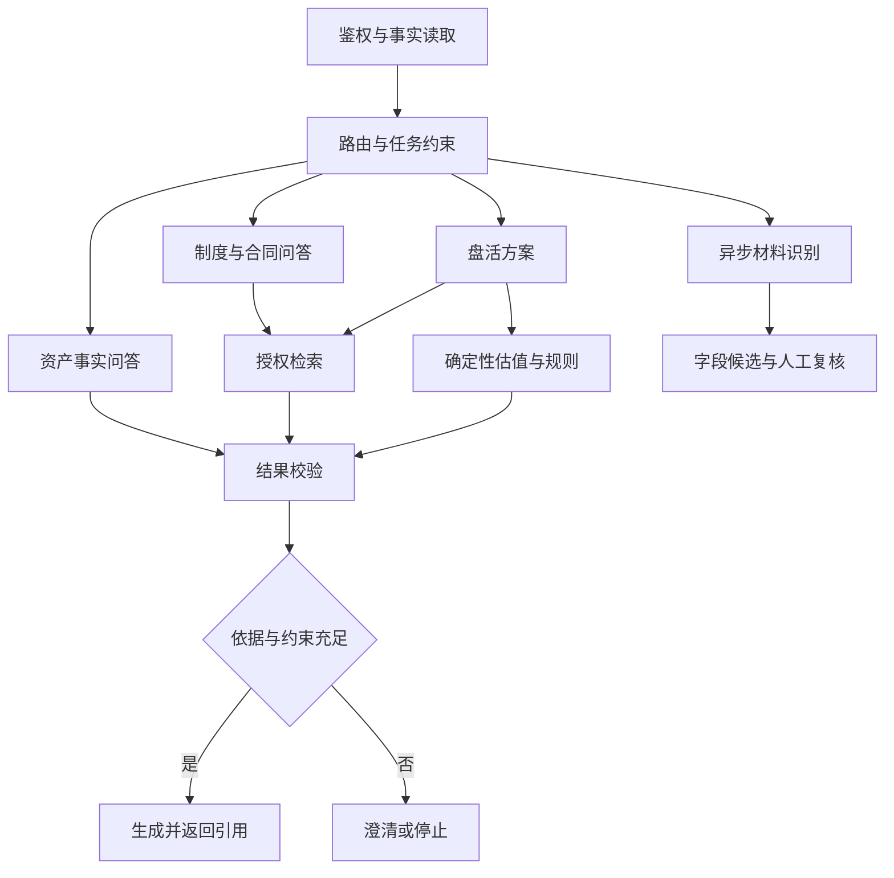

# AssetOps Agent：工程实战、量化成果与面试答辩指南

> 配套练习：[300 道面试题与第一人称回答](./Agent开发工程师面试300题与第一人称回答.md)，含 20 个专题、逐题追问与重点练习清单。

> **2026-10-16 补充**：[目标版简历](./Agent开发工程师简历_投递版.md)现为完整项目完成情景，包含多 Agent、MCP、Skill 与明确标注的模拟指标；详见[模拟指标与研发验收路线](./Agent目标版量化指标与研发验收路线.md)。本文已有实现基线仍按原核对日期理解，[当前实现简历存档](./Agent开发工程师简历_当前实现存档.md)保留原口径。模拟 CSV 只含人工计数，不是实际评测集。

适用：2 年开发经验，Java / Python，目标 Agent 应用开发。更新：2026-10-15。  
配套：[投递简历](./Agent开发工程师简历_投递版.md)｜[业务与代码面试手册](./Agent开发求职简历与项目面试指南.md)｜[成熟工程师表达版](./Agent项目包装与面试答辩_进阶版.md)

本文把招聘要求、当前实现、企业级演进与效果验证连起来。**“当前”指仓库实现；“设计”指本文提出的方案；“示例”中的数字只用于说明计算，没有执行相应压测或评测。** 已有测试文件与历史项目记录不能替代本次性能测量。

## 1. 招聘要求如何影响这份简历

### 1.1 本次实际读取的岗位样本

2026-10-15 尝试 BOSS、智联、猎聘公开页面。BOSS 搜索页面返回加载壳，移动列表跳到安全验证；猎聘返回页面导航，未读到可用的目标岗位正文。**不能据此宣称完整阅读了 BOSS 岗位，也不能给出招聘市场频次排名。** 智联搜索与下列公开职位正文可读取，作为定性参考；展示内容不保证职位仍在招，也未核验招聘方陈述。

| 样本 | 实际读到的要求摘要 | 对本项目材料的调整 |
| --- | --- | --- |
| J1：智联，大模型 RAG 工程师，爱动超越 | 专业领域文档预处理、检索排序、LangGraph 或类似框架实际经验 | 解释分块、版本、证据和检索评测；框架设计与框架实践分清 |
| J2：智联，大模型算法工程师（Agent Harness 方向） | 执行循环、状态 / 记忆、工具、恢复、模型调用与工程质量 | 以执行生命周期组织答辩，补充预算、状态机和故障边界 |
| J3：智联，应用与 AI Agent 可观测性工程师，科锐尔 | OTel、跨服务上下文传播、Workflow / LLM / Tool 链路与指标 | 讲清 trace / session / span 的区别和流式时间口径 |
| J4：智联，全栈开发【有 Agent 运用开发经验】，信必优 | 企业 API、FastAPI、React / TypeScript、PG / Redis、异步流程及交付 | 保留已有业务集成和端到端交付优势，而非只列模型知识 |
| J5：智联，AI 智能体开发工程师，北京致远万维 | 智能体框架、RAG、Python / Java、企业业务理解与界面集成 | 强化业务难点到技术机制的映射，保留 Java / Python 定位 |

这里只抽取与改写有关的要求，没有复制完整 JD。J1—J5 地址与访问范围见文末。J2、J4、J5 的公开说明涉及 2 年或以上经验，J1 标注 3 年及以上，J3 偏平台专岗；不应把所有岗位要求都当成同一职位的必选条件。

### 1.2 推荐投递策略

优先投 **Agent 应用开发 / 企业 AI 应用 / AI 后端**。用现有业务链路证明数据、权限、流式、任务和交付能力，再用可运行作品补 LangGraph、评测和工具执行。RAG 优化岗位应增加固定评测集与检索对照；可观测性平台岗需要补 SDK / OTel 实践；推理平台或算法岗另需 GPU、模型部署或训练证据。

下面是本次的写作判断，不是招聘网站统计：

- 简历主要写 **本人负责什么、用什么机制解决了什么问题、交付了什么结果**。
- 架构答辩主要讲 **失败如何发生、系统如何隔离、效果如何验证、为何先做某个优化**。
- 专有名词需要连到实现：说 Backpressure 就解释排队上限；说 Memory 就解释归属与遗忘；说 Checkpoint 就解释恢复和副作用。
- 先形成一条可复现的深链路，技术栈不必覆盖每份 JD 的全部标签。

## 2. 项目事实与企业级演进基线

| 能力 | 当前实现 | 企业级演进设计 |
| --- | --- | --- |
| 模型与业务集成 | 独立 AI 服务；业务端供给授权资产事实 | 统一 Model Gateway、租户级配额和预算 |
| 并发 | 识别链路采用进程内 Semaphore、Worker 与任务队列 | 分布式配额、交互 / 离线隔离、队列公平性 |
| 对话上下文 | 有输入长度边界与完整轮次裁剪；部分入口保存消息 | 服务端统一线程归属、分层记忆、摘要与 Token 预算 |
| 记忆 | `chat_memory_service.py` 为占位边界，没有摘要读写 | PG 消息真源、Redis 热缓存、Checkpoint、偏好 Store |
| RAG | 段落与标题 / 页码感知分块、向量检索、PG 授权 / 当前版本复核 | 混合检索、重排、父子块、跨文档证据、索引发布 |
| Embedding | 兼容接口适配，默认配置为 `local_hash` 回退 | 固定真实语义模型、版本与维度，离线基线评测 |
| Agent 编排 | 受控流程；方案链路组合事实、知识、估值、规则与生成 | LangGraph 状态图、有限工具循环、HITL、持久化恢复 |
| 工具协议 | 内部业务 Provider 调用 | Tool Registry / MCP 适配；协议不取代授权 |
| 沙箱 | 无任意动态代码执行能力 | 按需引入独立执行环境与资源 / 网络隔离 |
| 可观测性 | trace 标识、审计摘要与耗时等局部记录 | OTel 跨服务 span、模型 / 工具观测与评测关联 |
| 任务可靠性 | Redis 队列、状态认领、资产锁、重试、重启重排队 | 租约、幂等提交、Outbox / 可靠消费与故障回放 |
| 发布 | Docker Compose 等开发集成 | 根据规模补发布、监控、容量和故障演练 |

特别注意三个口径：

1. 默认并发配置不是部署实例数、线上吞吐或全局限制。
2. `local_hash` 能验证链路接通，不能证明语义检索质量。
3. 演示资产与成交种子数据不能写成客户真实规模、活跃用户或经营收益。

## 3. 如何处理用户并发：先说清瓶颈与指标

### 3.1 面试开场回答

> 我把并发拆成入口请求、流式连接、执行中的模型调用和完成任务四个层面。识别通过队列和独立 Worker 执行；交互流式则需要及时反馈排队、取消和失败。进程内信号量只保护当前进程，扩容后要结合模型供应商的 RPM / TPM 做全局预算。压测分别报告接收、排队、模型执行和成功完成，不能用接口快速返回 200 证明生成吞吐。

当前识别模块默认模型并发 2、任务并发 2、批次并发 1；这些是代码默认值，不代表所有对话入口都被同一个全局信号量覆盖。同步 Embedding / Milvus SDK 仍可能阻塞 async 事件循环，是需要先定位的优化点。

### 3.2 四个指标必须拆开

| 指标 | 计算对象 | 不能推出什么 |
| --- | --- | --- |
| HTTP 接入 QPS | 每秒到达 / 接纳的请求 | 不等于每秒成功生成回答 |
| 活动 SSE 连接 | 正在打开的长连接 | 不等于同时在上游生成 |
| 模型执行并发 | 真实占用上游调用槽的请求 | 不等于已排队任务数 |
| 成功完成吞吐 | 每秒收到明确成功终态的任务 | 要同时报告失败、拒绝和积压 |

**示例演算，不是项目成绩**：若稳定有 2 个模型槽，单次调用平均占用 30 秒，单任务只需 1 次调用，则理论模型瓶颈约为 `2 / 30 = 0.067 次/秒`，即每分钟约 4 次。若多步任务总共占用 60 个槽秒，约每分钟 2 个任务。输入长度、重试、服务商限制和利用率都会改变结果。

Little’s Law `L = λ × W` 用于稳定系统的**平均**在途数量、完成速率和停留时间；不能把 P95 时延直接代入推导确定的并发上限。

### 3.3 企业级处理路径（设计）

```text
鉴权 / 请求幂等键
  → 用户 / 组织入口限流
  → 估算输入与输出 Token，申请预算
  → 交互通道或离线队列
  → 带等待截止时间的执行槽
  → 模型 / 工具调用
  → 校验与持久化终态
  → 释放槽、结算真实用量、记录结果
```

- **限流与公平性**：按组织设置队列和并发配额，防止大租户独占；全局上限还要匹配服务商的请求与 Token 配额。先区分“额度暂不足”和“任务无效”。
- **背压**：队列设置长度 / 等待时间上限，满时明确拒绝或延后。无限排队只会把超时与内存问题推迟。
- **容量分离**：在线问答和批量 OCR 分队列、分预算，预留交互资源；不要让批处理吃满所有模型槽。
- **多副本**：Redis 原子预算或集中调度维护全局租约；占用附带期限、续租和拥有者标识。过期与旧执行者并存时用 fencing / 条件提交保护结果。
- **阻塞隔离**：先测事件循环延迟和线程池积压，再选择 async SDK、受限线程池或独立服务；不能无限 `to_thread`。
- **连接治理**：复用有界 HTTP 连接池；显式设置连接 / 读取 / 总任务超时；不在整个生成期间占住数据库事务。
- **重试预算**：只对合适的 429 / 临时故障有限重试，考虑 `Retry-After`、退避与抖动；禁止各服务层叠加重试放大成本。流式已输出后重试必须定义去重与重开语义。
- **取消传播**：用户停止后取消本地任务、关闭上游流，释放配额；供应商可能仍结算已生成内容，不能承诺取消即可零成本。
- **故障隔离**：单供应商失败可短期熔断，降级模型需重新核对上下文窗口、Schema 与质量，不能静默换模型后仍用旧评测成绩。

### 3.4 并发追问怎么落到证据

“支持多少用户”需要先问活跃比例和任务类型。100 个在线用户、100 个 SSE 和 100 个模型并行调用完全不同。给出硬件、副本、供应商配额、输入输出长度、到达模型、持续时间以及队列是否稳定，再谈容量。若积压持续增加，短窗口接纳率不能称为稳态吞吐。

## 4. 记忆设计：持久化消息不等于完整 Memory

### 4.1 当前能怎样回答

当前对话携带受限历史，部分接口保存会话 / 消息，尚无统一的长期记忆读写或摘要压缩。独立 Memory 服务目前是占位实现。可以讲清已有完整轮次裁剪与持久化边界，再展开下面的设计，不把规划说成已上线。

### 4.2 四层存储设计

| 层 | 保存内容 | 真源与有效期 | 关键控制 |
| --- | --- | --- | --- |
| 消息日志 | 用户消息、可见回复、工具调用结果与终态 | PG 追加存储，按业务保留策略 | tenant / user / thread 归属、顺序、删除 |
| 执行状态 | 当前节点、已完成工作、证据引用、预算、审批状态 | 持久化 Checkpointer | state / graph 版本、恢复重验 |
| 热上下文 | 最近完整轮次、摘要缓存、近期检索结果 | Redis，有 TTL | 缓存失效、拥有者校验、权限版本 |
| 长期偏好 | 用户确认的语言、输出模板、关注维度 | 有来源与撤回机制的 Store | 显式确认、作用域、更新时间 |

**业务事实重新查询**：资产面积、租金、权属、合同状态和组织权限来自业务服务。摘要只存“用户关注 A-001 的出租方案”等意图和引用，不把上次回答的价格当成下次的权威事实。

### 4.3 多用户与并发写入

服务端从身份上下文生成作用域；仅拼 Redis key 并不能完成授权。访问 thread / session / checkpoint / 文件都要校验归属。当前代码的会话复用逻辑还需要逐入口核对，不应宣称整个系统已经具备统一会话隔离。

同一 thread 的并发请求可采用“单活动 run + 可取消 / 排队”规则；或通过消息序号和版本号 CAS 控制提交。摘要记录 `covers_through_seq`，仅覆盖已成功落库的完整轮次，避免两个请求把新消息覆盖。工具结果以 `tool_call_id` 去重，异步返回按因果关联组织。

### 4.4 遗忘与污染处理

用户删除会话时应联动清理消息、摘要、缓存和派生检索；依法 / 按业务保留的审计另行约束访问。组织权限撤回后，即使旧摘要仍在，也必须禁止旧引用再次进入模型上下文或下载接口。

文档内容、工具返回和历史模型回复都是数据，不能升级为 system 指令。长期偏好不接受“以后绕过权限”“忽略规则”等内容。重要偏好要能查看、修正、撤回；Prompt Injection 的识别与过滤只是辅助，真正的权限仍在工具与服务端。

## 5. 上下文压缩：预算、保真与成本一起设计

### 5.1 先计算预算，再决定压什么

设计公式：

```text
可用输入 = 模型窗口 − 预留输出 − 安全余量
输入 = 系统约束 + 工具 Schema + 当前问题 + 权威事实
     + 当前证据 + 历史 / 摘要 + 其他工具结果
```

**示例**：32k 窗口预留 4k 输出与 2k 余量，输入上限 26k Token。按所用模型 tokenizer 计数，不能把 1000 中文字符当成 1000 Token，也不能沿用换模型前的估计。

当前 20 条历史、总字符数等限制只是输入保护，不是上述 Token 预算实现。完整轮次裁剪也不等于语义摘要。

### 5.2 四步压缩方案（设计）

1. **选择 Select**：保留当前问题、身份约束、当前事实与最相关证据；历史按任务相关性与时间选取，去掉重复解释。
2. **压缩 Compress**：对较早完整轮次增量摘要；合并重复检索片段。保留否定、数字、单位、版本与来源。
3. **外置 Externalize**：长表格、完整工具输出放结果存储，模型只看必要字段与有权限的引用；需要时经工具重新读取。
4. **重验 Revalidate**：重新读取业务事实，检查摘要覆盖范围、证据权限及版本，预算仍超限就澄清或拆任务。

不能裁掉 system 权限规则；不能留下没有对应调用的 tool result 或丢掉调用参数后还要求模型解释结果。模型和供应商的消息协议可能不同，需要按实际协议保持调用与结果配对。

### 5.3 结构化摘要示例

```json
{
  "schema_version": 1,
  "covers_through_seq": 24,
  "intent": "比较出租与转让方案",
  "asset_refs": ["A-001"],
  "confirmed_constraints": ["暂不年化租赁价值"],
  "unresolved": ["合同租金计价周期待核实"],
  "evidence_refs": ["doc:18@rev:3/page:6"],
  "next_step": "读取现行合同并核对计价周期"
}
```

摘要失败时可退回最近完整轮次，限制长度并提示用户缩小问题。摘要必须可从原消息重建；模型生成摘要后仍需 Schema 与关键约束核验。不能以摘要代替数据库事实。

### 5.4 量化方式

输入 Token 压缩率：`1 − 优化后输入 Token / 基线输入 Token`。**示例**：12000 → 7200 为 40%；这不代表端到端成本也下降 40%，必须加摘要调用、检索、输出与失败重试开销。

评测需同时看关键事实保留、约束遵循、来源一致、任务成功率与每成功任务成本。长会话测试要覆盖金额单位、用户纠正、权限改变、跨轮否定和中断恢复；只看摘要读起来流畅无法证明有效。

## 6. Sandbox：隔离什么，何时才需要

当前系统没有任意代码执行沙箱。若只是查询台账和执行确定性估值，优先暴露受控领域 API；若未来允许模型分析 Excel、运行 Python 或处理不可信文件，再引入独立执行环境。

### 6.1 工具授权与执行隔离是两道边界

Tool Schema / allowlist 控制模型能请求的动作，Sandbox 控制工具失陷或代码越界后的影响。Python `exec` 限制 globals、过滤关键字或限制 import 都不足以构成安全隔离；普通容器的默认配置也不等于强隔离。

### 6.2 企业级执行设计

```text
模型提出分析任务
  → 服务端校验工具 / 参数 / 数据范围
  → 复制最小授权数据到临时工作目录
  → 调度隔离运行环境
  → 限时执行并收集输出
  → 校验文件 / 结果 / 所有权
  → 返回受控结果引用并销毁环境
```

- 每任务临时环境，非 root、只读根文件系统、独立临时盘；限制 CPU、内存、PID、磁盘、运行时间和输出大小。
- 删除不需要的 capabilities，结合 seccomp / AppArmor；根据风险与平台能力选择 gVisor 或微虚拟机等更强边界，而非声称任一方案绝对安全。
- 默认拒绝网络，按任务开放必要出口；控制重定向、DNS 与内网 / 元数据地址，避免任意 URL 工具成为 SSRF 入口。
- 不挂 Docker socket、宿主业务目录或长期密钥；需要服务访问时通过短期最小权限凭证或受控代理。
- 原始敏感数据最小化，生成文件限制路径、类型和数量，防目录穿越 / 符号链接越界；下载和结果引用再次校验拥有者。
- 写业务数据、发通知或触发交易时采用独立审批与幂等接口，不能让沙箱拿着数据库管理员凭据直连生产。

验收包括死循环、内存耗尽、进程泛滥、越界读写、符号链接、外连与取消清理等负向案例。报告测试范围与残余风险，不能仅凭“跑通容器”宣称实现安全沙箱。

## 7. LangGraph 多链路：状态、依赖和恢复比节点数量重要

### 7.1 为什么引入，什么情况下先不用

当前受控流程可以通过普通函数和服务编排完成。若业务需要多路径、并行证据、暂停审批或长任务恢复，LangGraph 的显式状态、条件边和持久化能力才带来具体收益。多链路不等于必须多 Agent；不同专业模型也不是每个节点的必要条件。以下为设计方案，尚未接入当前系统。



图为概念依赖：方案路径需等待必需的知识与领域计算完成后再校验。普通问答路径不应等待无关分支；实际建图要设置路径自己的汇合条件，防止把所有入口都接到同一固定 barrier 造成等待。

### 7.2 四条业务路径

| 路径 | 输入与动作 | 可结束条件 |
| --- | --- | --- |
| 事实问答 | 读取授权资产，计算确定性汇总，解释字段 | 事实充足或明确缺失 |
| 知识问答 | 查询改写、授权检索、证据组织、引用回答 | 证据支持回答或拒答 / 澄清 |
| 盘活方案 | 事实完整性 → 并行知识 / 可比估值 → 规则校验 → 草稿 | Schema / 规则满足，或等待人工决策 |
| 材料识别 | 提交任务、后台解析、输出字段与页码证据 | 待复核、部分成功或明确失败 |

Router 只选受控枚举，不可用模型输出决定用户能访问谁的数据。查询改写不能把用户无权限的实体加入检索。依赖相同事实且彼此独立的检索 / 估值才并行；缺少关键字段时先补资料。

### 7.3 状态契约示例（设计）

```text
run_id / tenant_id / user_id / thread_id
state_schema_version / graph_version
route / question / selected_asset_refs
facts_snapshot_ref / permission_epoch / as_of
retrieval_release / evidence_refs / valuation_result
messages / tool_call_records / remaining_budget
approval_state / errors / final_status
```

大对象与敏感原文外置，状态保存授权引用；不要把运行数据库连接、HTTP client 或未序列化对象放进 checkpoint。并行分支按 evidence ID 或 tool call ID 合并去重，避免简单追加导致恢复后重复。预算消耗需原子扣减或有明确结算方式，不能让并行分支各自拥有完整剩余额度。

### 7.4 Checkpoint 不能自动解决外部副作用

Checkpoint 持久化图状态，不会自动让发消息、写资产、创建合同这些外部动作 exactly-once。每次副作用分配稳定业务幂等键；外部提交与状态记录不在同一事务时，使用幂等结果查询、Outbox 等机制协调。重放时能识别“已经执行成功，但状态没记下来”。

恢复前重新验证身份、权限、证据版本与审批有效期，明确继续旧知识快照还是重新规划。普通对话用户停止应取消执行；后台识别或等待审批可以脱离连接继续，重连用事件序号恢复展示，不能把“断开 SSE”统一当成“任务取消”。

HITL 批准的是某个具体动作及其参数摘要；资产、金额或参数变化后重新审批。给循环设置步骤、时间、Token、金额预算，以及重复无进展检测。最多重试一次或两次是策略示例，需要按故障成本验证，不能无限 self-reflection。

### 7.5 MCP 的正确答法

MCP 可作为工具 / 资源接入协议，便于标准化客户端与服务端集成；它不负责证明工具可信，也不取代身份授权、输入校验、幂等、审计或沙箱。现有内部 Provider 可以逐步适配，先定义业务工具契约，再决定是否需要额外协议层。

## 8. 链路追踪：回答“慢在哪里”和“为什么失败”

当前审计包含 trace 标识、操作、状态、耗时与元信息，不等于 OTel 全链路已完成。以下为待实现的观测设计，依据 OTel 上下文传播概念组织，见 T3。

### 8.1 Trace 结构

```text
HTTP /ai/run                            root span
├─ auth.scope                           权限与范围
├─ asset.facts                          事实查询
├─ context.build                        Token / 摘要 / 版本
├─ workflow.run
│  ├─ retrieval
│  │  ├─ embedding
│  │  ├─ vector.search
│  │  ├─ acl.recheck
│  │  └─ rerank                         采用后再记录
│  ├─ domain.valuation
│  ├─ llm.generate
│  └─ output.verify
└─ result.persist
```

- `trace_id` 对应一次执行的因果链；`session_id / thread_id` 关联多轮交互；`run_id` 对应一次业务运行。会话可以包含多条 trace。
- 服务间传播 `traceparent` 等上下文；队列消息携带受控的 trace 元数据。Worker 消费时创建 consumer span；长时间异步任务可用 span link 关联，不能强行把每个后台操作串成同一个超长请求。
- 日志带 trace / run 标识便于查询；指标标签限制基数，避免把用户 ID、完整问题或每个资产 ID 当 Prometheus label。

### 8.2 要采什么

| 阶段 | 观测内容 | 主要用途 |
| --- | --- | --- |
| 入口 | 到达、接纳、拒绝、排队时间、取消 | 区分容量不足和执行慢 |
| 检索 | 索引 / Embedding 版本、候选与授权后数量、耗时、证据引用 | 排查召回损失与版本变化 |
| 模型 | 模型 / Prompt 版本、输入输出 Token、首内容时间、总耗时、重试与终态 | 时延、成本与质量关联 |
| 工具 | 名称 / Schema 版本、参数摘要、超时、结果大小、业务错误 | 找到失败工具与重复执行 |
| 校验 | 缺依据、Schema 错误、金额单位冲突、拒答原因 | 建立失败分类 |
| 结果 | 是否完成业务任务、人工采纳 / 修改反馈 | 评测与产品改进 |

TTFT 至少区分“用户发起到首个可见内容”“模型请求到首个内容”的时间。SSE 心跳、status 或 meta 不是首个回答 Token。重试、取消、超时等也记录，不能只分析成功请求造成幸存者偏差。

### 8.3 观测、审计与隐私

常规遥测采用脱敏、异步导出、背压与采样，采集系统故障不应拖垮生成。需要完整留存的业务审批 / 副作用审计另走可靠持久化路径，不可跟随普通 trace 抽样丢失。对失败采样与尾部采样的存储成本单独评估。

不保存模型隐藏思维链。保存可观测的输入摘要、工具调用、证据引用、结果与校验；需要调试原文时按授权、期限和脱敏规则控制访问。

## 9. RAG 分块：按资料类型保留可回答的证据

### 9.1 当前实现的准确表述

仓库将换行统一后按空段落组织文本，保留简单标题信息和 PDF 页码标记；默认每块上限 1000 **字符**，长段按行或字符截分，短事实条目仍保留。它不是 Token splitter、语义分块、父子检索或完整章节树，没有现成 overlap 算法。

当前检索先取 `top_k × 4` 候选，但底层返回硬上限 20，再由 PG 复核授权 / 当前版本，最后取目标 TopK。因此增大 `top_k` 并不保证候选线性增加，后过滤还可能耗尽候选。没有现成 BM25、RRF 或 reranker。

### 9.2 文档分流设计

| 资料 | 分块单元 | 必须保留的字段 / 结构 |
| --- | --- | --- |
| 制度 / 管理办法 | 章、条、款，附上下文 | 制度名、条号、适用组织、生效期、例外和否定 |
| 合同 / 补充协议 | 条款与实体关联 | 合同 / 资产 ID、签约主体、期限、金额单位、修订关系 |
| 资产卡片 | 一项资产的字段组 | 资产 ID、公司、面积 / 价值单位与更新时间 |
| 表格 / 清单 | 表头与若干行 | 多级表头、单位、行列坐标、合计语义 |
| 扫描 PDF | 版面块结合 OCR | 页码、坐标、OCR 置信与原图引用 |
| FAQ / 短事实 | 完整问答或短事实 | 不为凑长度把不同实体混进同块 |

候选实验可以比较约 300–600 Token 的块、50–100 Token 的重叠，但这只是待验证区间。按合同条款、表格结构与模型实际 tokenizer 调整，不能把固定块长当成通用最优。

### 9.3 父子分块与跨页

设计上用小子块做精确召回，再取授权父块补语义；设置每文档配额和扩展 Token 预算，避免一个超长父章节占满上下文。子块带父块 ID、来源位置和版本，扩展后再次做 ACL 与生效期判断。

跨页条款可将连续文本关联，但保留来源页范围；重复页眉页脚按版面与重复性识别。不能简单把每页当独立完整语义，也不能去掉全部重复文本导致合同每行必需的单位 / 表头丢失。多栏 PDF、脚注、盖章遮挡和图片表格需要单独质检。

### 9.4 优化路线

先看解析质量和实体 / 版本标签，再评估检索算法。可设计向量 + BM25 两路召回，按权限过滤后融合、去重与重排；RRF 通过名次融合减轻跨检索器分数尺度不一致，不代表不需调参和评测。reranker 应按领域难例测试，不能假设加入后所有类别都提升。

关键编号、公司名、金额条件优先利用精确匹配和结构化过滤；语义检索补自然语言表达。公司名别名表要经过业务确认，不能靠模糊匹配把不同公司归到一起。

## 10. 特殊符号、OCR 与表格：为检索归一化，为依据保真

### 10.1 双文本与结构化字段方案

设计中保存原始文本 / 文件、检索归一化文本、结构化字段及位置映射。检索用规范化表示，引用与复核回到原文；Embedding、关键词检索和引用可以使用不同的视图，全部记录处理版本。

| 业务原文 | 可用于检索的补充表示 | 不允许丢失的含义 |
| --- | --- | --- |
| `12.50 元/㎡/月` | 单位别名 `元/平方米/月`，数值字段 12.50 | 月租金不能变成年租金 |
| `≤1000㎡` | 运算符、数值、单位分字段 | `≤` 不能清洗成空格或误变为 `<` |
| `2026〔12〕号` | 文号标准字段，保留原样 | 年份、序号和发文主体 |
| `A-01/002` | 资产编码原值与业务确认的别名 | 不能随意去掉 `-`、`/`、前导零 |
| `1,200.00` | 按语境解析为 Decimal | 千位符 / 小数点存在语言差异 |
| `O / 0`、`l / 1` | OCR 候选与置信标注 | 不允许全局自动替换 |

Unicode NFC / NFKC 的效果不同；兼容归一化可能将 `㎡` 等兼容字符改写。按字段与语言制定规则并保留 raw 值，不能机械地全量 NFKC 后再声称原文未变。Unicode 规范见 T6。

### 10.2 典型坏方案

“删除所有标点和特殊符号”会破坏编码、负数、百分比、条号和金额单位。“把所有换行变空格”会破坏表头与条款边界。“遇到乱码直接忽略”可能删掉关键金额或限制条件。

针对不间断空格、零宽字符、全角符号和软换行分别处理；替换字符 `�`、提取空白页、金额低置信等进入解析告警，必要时更换解析器 / OCR 并人工复核，不默默输出错误事实。识别置信是处理信号，不能宣称它是已校准的正确概率。

### 10.3 回归样例

至少准备单位与周期、不等式、带符号资产编号、中文文号、合并单元格、跨页表格、OCR 字符混淆、否定条款等样例。对每个样例同时检查结构化值、检索命中、原文定位和最终回答。不能仅以“文本非空”认定解析成功。

## 11. 跨文档问答：从相似片段升级为证据关系

示例问题：**“A-001 资产现行租金、剩余租期以及提租是否符合集团制度？”** 可能需要台账、原合同、补充协议、现行制度四类证据。仅召回同一个问题的多个相似段落不算完成跨文档推理。

### 11.1 证据组织设计

1. 从授权资产 ID 绑定实体，核对合同号、主体与资产关系；模糊同名只作候选。
2. 将问题拆成租金、期限、适用规则等子问题，各自建立证据需求。
3. 结合精确 ID、关键词与向量检索，沿 `amends / supersedes / applies_to` 等已核验关系找补充协议和制度。
4. 按签署状态、生效期、失效期与适用主体决定效力；最近上传不等于最新有效。
5. 建立证据矩阵，缺任一必要依据就输出缺口；冲突不能靠模型“选一个听起来合理的”。

| 待回答字段 | 首要依据 | 冲突与缺口处理 |
| --- | --- | --- |
| 现行租金 | 有效补充协议及原合同引用 | 补充协议未生效则不能覆盖；周期不明不年化 |
| 剩余租期 | 合同期限与有效变更 | 需指定计算日期，并说明终止 / 续签情况 |
| 提租约束 | 对该主体、该事项有效的制度条款 | 规则冲突或缺授权材料则交人工确认 |

跨文档允许部分回答，但要区分确定结论与待核实问题。法规解释和审批决定仍由业务负责。

### 11.2 不急着上 GraphRAG 的理由

合同 ID、资产 ID、修订与适用关系若本来就结构化，先用关系表和规则查询更可控。自由文本关系广、实体歧义高、跨文档多跳任务多时再评估图检索，包含实体抽取、关系核验和更新成本。知识图谱不自动消除版本、权限或幻觉问题。

## 12. 版本与权限：不仅是 `is_current`

### 12.1 至少管理四类版本（设计）

| 类别 | 关键标识 | 解决的问题 |
| --- | --- | --- |
| 业务文档 | logical_doc_id、revision、content_hash、effective_from / to | 同一合同修订、生效与历史查询 |
| 处理 / 索引 | parser / normalizer / splitter、Embedding 模型 / 维度、index_release | 相同原文经不同处理得到不同向量 |
| 推理 | Prompt、模型、检索参数、工具 Schema / 规则版本 | 重现一次回答的生成条件 |
| 执行状态 | graph_version、state_schema_version、审批绑定摘要 | 发布后旧任务能否安全恢复 |

上传时间、法律 / 业务生效时间、系统入库时间要区分。历史分析需要明确 `as_of`；当前权限原则上仍按现在的授权执行，不能因为问历史而复活已撤回权限。是否需要完整双时态模型，按审计需求决定。

### 12.2 无空窗发布流程

当前向量更新存在删旧再写新路径，`is_current` 只是过滤属性，不等于完整发布事务。PG 与向量库之间也没有天然跨库原子提交。

设计流程：

```text
接收新修订，保留旧版
  → 解析 / 清洗 / 分块，记录版本
  → 写 staging 索引并检查维度、数量、来源与 ACL
  → 评测与完整性通过，标记 ready
  → 发布清单切换 active release
  → 请求固定 release 快照
  → 观察 / 回滚；延迟清理旧版
```

发布清单在权威库 / 控制面管理。读取者只检索 ready 且属于固定 release 的向量，切换失败保留旧版本；旧版清理需考虑在途请求。不能仅在 PG 改一行就假定向量库全部可读。

Embedding 模型或维度改变时重建对应集合 / 索引，并绑定查询侧同版本模型。不同模型即使维度相同也不应混查比较相似度。

### 12.3 缓存与权限变化

缓存键按实际依赖包含组织 / 用户或授权范围摘要、权限版本、资产事实版本、索引 release、Prompt / 模型版本及请求参数；仅按问题文本缓存会产生串权与旧答案。涉及敏感数据时优先短 TTL、重验权限和按业务失效。

ACL 预过滤减少无权限候选挤占召回，但索引元数据可能滞后；返回前由权威权限再次核验。撤权优先设置立即拒绝 / 失效机制，覆盖缓存、历史引用、导出、checkpoint 和文件下载，再异步修复向量元数据。不能靠用户看不到列表就认定所有入口均已隔离。

## 13. 量化成果：把数字写成能复现的工程证据

### 13.1 当前哪些数据可以用

| 类型 | 当前情况 | 简历用途 |
| --- | --- | --- |
| 输入 / 配置边界 | 代码可核对，例如 10 项资产、20 条历史、1000 字符分块 | 描述处理边界，不能标成吞吐成果 |
| 功能交付 | 流式、后台识别、方案快照、引用等可定位实现 | 可写交付结果，不虚构节省工时 |
| 实测性能 | 本次没有执行 QPS / TTFT / 并发压测 | 保留测量模板 |
| 检索效果 | 本次没有冻结标注集与对照实验 | 不填写实际 Recall 提升 |
| 演示数据 | 台账 / 成交种子用于演示 | 不代表真实业务量或盘活收益 |
| 下面的算例 | 假设值，用于解释公式与面试口径 | 不能直接抄成工作成绩 |

数字的说服力来自“样本、环境、基线、改动、结果、代价”。没有测量时，具体交付结果比凭空写 99% 更经得起追问。

### 13.2 固定 RAG 评测集怎么建（计划，尚未建成）

建议先准备 **200 条**候选问题：60 条资产事实、60 条单文档、40 条跨文档、20 条版本冲突、20 条资料不足 / 权限边界。这个配比是本项目的评测设计，不是已有客户数据统计。

- 从可授权使用的业务材料抽样，脱敏并记录数据来源。LLM 可以辅助生成问题，但金标需人工复核。
- 按文档家族 / 合同关系 / 实体分组拆分开发与锁定测试集，避免原合同在开发集、同一合同补充协议在测试集造成泄漏。
- 锁定资料快照、授权身份、查询日期、答案要点、必要证据与允许的替代证据；不只标“正确答案字符串”。
- 单独标记无答案与越权问题，不放入 Recall 的有答案分母；权限测试目标是拒绝或不泄露，不能以召回无权限证据作为加分。
- 金标优先用稳定原文片段 / 条款 ID / 证据组。改变切片后映射回证据，不能因为多复制重叠块就“提高召回”。
- 每个类型报告样本数和失败例；小样本区间较宽，不声称可以代表全部业务。

推荐样本契约：

```json
{
  "question_id": "crossdoc-001",
  "category": "cross_document",
  "principal_fixture": "group_user_fixture",
  "query": "A-001现行租金与提租约束是什么？",
  "as_of": "2026-10-15",
  "corpus_release": "fixture-v1",
  "answerable": true,
  "required_evidence_groups": [
    ["contract:001/rev:2/clause:5"],
    ["supplement:003/rev:1/clause:2"],
    ["policy:008/rev:3/clause:12"]
  ],
  "critical_assertions": ["租金周期明确", "不混用失效制度"]
}
```

上例为虚构测试标识；每组内可放等价替代证据，组与组之间为必须覆盖的条件。生成答案的模型不能同时充当唯一裁判，重点失败类需要人工复核与一致性检查。

### 13.3 召回、证据与回答质量分开算

对有答案问题 `q`，以必要证据组集合 `Gq` 和 TopK 检索命中的证据组 `Rq` 为基准：

```text
Recall@K(q) = |Gq ∩ Rq| / |Gq|
宏平均 Recall@K = 对所有有答案问题的 Recall@K(q) 求平均
Hit@K = 至少命中一个必要证据组的问题比例
证据完整率 = 全部必要证据组都被覆盖的问题比例
```

跨文档问题命中 1 / 3 组时，Hit 可以为 1，Recall 只有 1/3，完整率为 0。只有每题单一金标证据时 Hit 才与该口径 Recall 相同。不要将“含任意正确片段”叫做“完整召回”。

回答层另测：关键断言正确率、引用是否支持对应断言、来源定位正确、无依据拒答与越权泄露。答案语气自信和来源数量多不代表有依据。LLM-as-a-Judge 固定评测 Prompt / 模型版本，报告抽查和分歧，不把其打分当成绝对真值。

**示例演算，非项目结果**：100 条单一金标证据的问题，基线命中 70 条、优化后命中 85 条：`70% → 85%`，提升 **15 个百分点**，相对提升约 **21.4%**。不能混写“提高 15%”而不说明口径。真实对照还要看失败交叉表、分组结果和置信区间，避免只展示总分。

### 13.4 检索消融实验

| 版本 | 变化 | Recall@5 | 跨文档完整率 | 检索 P95 / 成本 |
| --- | --- | --- | --- | --- |
| B0 | 当前真实语义 Embedding + 向量基线 | 待测 | 待测 | 待测 |
| B1 | B0 + 解析质检、条款 / 表格保真 | 待测 | 待测 | 待测 |
| B2 | B1 + 授权候选策略、关键词 / 向量融合 | 待测 | 待测 | 待测 |
| B3 | B2 + 重排与受限父块扩展 | 待测 | 待测 | 待测 |

B0 需要先确认实际运行的模型；默认 `local_hash` 不作为语义质量基线。每次固定数据与评测集，先在开发集调参，再一次性验证锁定集。记录回退问题：总分变好但少数金额 / 版本类变差，也可能不能发布。

### 13.5 并发与流式压测方案（未执行）

分四层压，避免把代理速度当模型速度：

| 层 | 上游 | 能证明 | 不能证明 |
| --- | --- | --- | --- |
| 普通短接口 | 业务 DB / 缓存 | 接口、查询与连接容量 | 模型生成吞吐 |
| 检索接口 | 明确是真实还是替身 Embedding / 向量库 | 检索路径时延与吞吐 | 最终答案质量 |
| 流式框架 | 可控延迟的模拟模型 | SSE、取消、心跳与资源回收 | 真实供应商容量与费用 |
| 真实模型 E2E | 固定供应商 / 模型 / 长度 | 实际用户体验、完成吞吐与成本 | 未测负载与其他模型的表现 |

短接口可以从 1 / 5 / 10 / 20 QPS 逐级探索；真实模型从 1 / 2 等少量活动调用起步，是否继续必须受配额与费用预算约束。这些是候选测试梯度，不是承诺支持的流量。预热与测量窗口例如 1 分钟 + 5 分钟只是起点，长任务要有足够完成样本和稳定队列，才能计算有意义的尾部时延。

每轮记录：硬件、进程 / 副本、Worker 数、模型配额、输入输出 Token 分布、到达率 / 接纳率 / 拒绝率、活动连接、模型执行并发、排队时间、TTFT、总耗时、完成吞吐、取消与错误分类、资源占用。固定 offered load 的实验比单纯闭环“上一条完了再发”更容易暴露积压；客户端也要记录预定到达时间，避免负载发生器自身卡顿掩盖排队。

- HTTP 200 不等于成功：SSE 必须有明确成功终态，无 `done` 的 EOF、error、中断和超时分别计数。
- P95 标明样本范围：成功请求的分位数、所有请求的成功 / 超时比例一起提供；失败不能被静默剔除。
- 延迟指标从用户提交和从上游调用分别计算；首个心跳不算 TTFT。
- 终止输入后观察队列排空；错误重试和取消也计入消耗。

建议结果表：

```text
run_id / commit / environment / dataset / model
arrivals / admitted / started / completed / succeeded / rejected / cancelled
mean_queue_ms / p95_queue_ms / p95_ttft_ms / p95_e2e_ms
active_sse_peak / upstream_inflight_peak / sustained_success_tasks_per_sec
total_tokens / billed_cost / cost_per_success / remaining_backlog
```

### 13.6 上下文、成本与恢复指标

| 目标 | 指标 / 分母 | 避免的误判 |
| --- | --- | --- |
| 上下文减少 | 同组任务平均 / 分位输入 Token；关键事实保留 | 单个短问题下降不能代表长会话 |
| 成本优化 | 全部调用实际账单 / 成功完成的业务任务数 | 只算主模型，漏掉摘要、重试和失败 |
| 缓存收益 | 合法命中 / 可缓存请求；答案新鲜度 | 命中旧权限或过期事实不算收益 |
| 任务恢复 | 故障后在截止时间内恢复成功 / 故障任务 | 自动重排队不代表最终完成 |
| 副作用安全 | 重复业务写入、孤儿结果、幂等冲突 | 不等同于只看队列去重数 |
| 人工效率 | 相同任务的人工完成时间与复核时间分布 | 不能拿纯生成时间等同于节省工时 |

恢复演练点包括领取前后、模型执行中、结果落库前后、锁过期和 Worker 重启。记录恢复起点是“故障发生”还是“服务恢复”；任务可重做与副作用不可重做分开判断。当前没有完成这些实验，不能把 Redis 机制直接写成“99.9% 可靠”。

### 13.7 实测后怎样替换简历

- RAG：“基于 `[N]` 条冻结标注问题，通过 `[具体已落地变化]`，Recall@5 从 `[A]` 提升至 `[B]`，跨文档完整率 `[C]`；检索 P95 为 `[D]`，给出成本变化。”
- 并发：“在 `[环境]` 下，持续 `[时长]` 处理 `[负载]`，成功完成吞吐 `[X]` 任务/秒，TTFT P95 `[Y]`，拒绝 `[Z]%`、错误 `[E]%`，队列保持稳定。”
- 记忆：“在 `[N]` 组长会话上，输入 Token 降低 `[X]%`，含摘要开销的每成功任务成本降低 `[Y]%`，关键事实保留 `[Z]%`。”
- 恢复：“覆盖 `[故障点]` 的 `[N]` 次故障注入，`[M]` 次按期恢复，重复业务写入 `[K]` 次，恢复 P95 `[T]`。”

优化后效果提升但新增复杂度、成本或延迟，也要能解释是否值得。没有必要用每个指标都“巨大提升”包装项目。

## 14. 30 个常见追问与回答骨架

这些是按本项目整理的练习题，**不是声称来自某公司的真实面经或题频统计**。回答顺序建议：业务约束 → 当前实现 → 失效模式 → 设计 / 实验 → 结果边界。

1. **你做的是 Agent，还是普通聊天接口？** 目前是业务 AI 助手与受控流程，具备事实、检索、领域计算和结构化交付；动态自主工具循环尚未接入。Agent 化的价值在于按任务选动作、观察结果并受预算约束地继续执行，不能只靠命名证明。
2. **为什么不用一个大 Prompt 完成所有任务？** 权限、金额、状态恢复和审批需要确定性边界；长 Prompt 无法替代工具授权与持久化。模型负责理解和表达，规则 / 领域程序承担关键校验与计算。
3. **一千用户同时来怎么办？** 先区分在线、提交和真实推理；按配额接纳、队列有界、交互与离线隔离，给出排队 / 拒绝反馈。容量用完成吞吐与稳态积压实测，不承诺无条件一千并发推理。
4. **async / await 为什么还卡？** 检查同步 SDK、CPU 解析、线程池、连接池与数据库事务。async 不是自动非阻塞；当前同步 Embedding / Milvus 调用就是需要核对的路径。
5. **多副本 Semaphore 有用吗？** 对本进程有用；每进程 2、4 个进程可能有 8 个调用，并不是全局 2。需要全局配额和租约，并结合实际部署验证。
6. **服务商 429 怎么处理？** 区分 RPM、TPM 和瞬态故障；按上游信号有限退避，加总预算、取消和截止时间；不能每层自动三次导致调用倍增。
7. **长会话记忆存 Redis 就够吗？** Redis 适合热缓存；持久消息、执行状态和偏好应分层。归属、覆盖序号、过期、删除和权限改变需要设计，不能只说用了 Redis。
8. **历史会话会串用户吗？** 服务端按主体校验所有 thread / session / checkpoint / 下载入口；ID 不可预测不是授权。现有会话复用入口需逐项验证，不能把 key 前缀当完整隔离。
9. **用户说“那套资产”怎么知道是哪套？** 摘要与近期轮次保存实体引用；存在多个候选就澄清。解析出的实体还要重新授权、查询事实，不能靠历史回答回填。
10. **摘要越压越错怎么办？** 结构化摘要、覆盖序号、关键约束校验、保留原消息并定期重建。对金额 / 单位 / 否定做专项回归，必要时退回裁剪与澄清。
11. **为什么不把所有历史都塞进去？** 窗口、费用、噪声与延迟有限；按任务选择和预算组织。更长窗口也可能夹带过期事实与恶意指令。
12. **模型能不能直接执行 SQL？** 优先领域查询工具、参数化模板与行级授权；必要的分析 SQL 走只读受控路径，限制语句、扫描量和超时。AST 校验、LIMIT 都不能单独保证无越权或低成本。
13. **工具白名单就是沙箱吗？** 白名单约束入口，沙箱约束执行影响。还需要隔离环境、网络、资源、文件与凭证边界，并做负向测试。
14. **LangGraph 能解决什么？** 显式状态、路由、并行、暂停与持久化恢复。简单固定流程普通代码也能做，不为框架增加无必要的复杂度。
15. **Checkpoint 后重跑会重复转账 / 发通知吗？** 会有风险；外部副作用需要幂等键、结果查询和事务协调。Checkpoint 不提供跨系统 exactly-once。
16. **为什么要多 Agent？** 只有角色权限 / 工具 / 上下文或并行任务确实不同才拆；先评估沟通 Token、冲突和尾部延迟。多数现有链路可先用单 Agent 加领域工具。
17. **TraceId、SessionId 和 SpanId 有什么不同？** Session 跨多轮，trace 关联一次执行，span 代表阶段；异步任务用传播上下文或 link，不能仅在日志随机写同一个字符串。
18. **如何知道回答慢在模型还是检索？** 分排队、事实查询、Embedding、检索 / 重排、上游首内容、生成与验证；统一时间口径，查看分段分位数和错误分布。
19. **切片为什么选这个长度？** 当前 1000 字符是实现默认；后续按文档类型保条款 / 表格边界，用固定集比较候选长度，质量、成本和上下文占用一起看。
20. **合同跨页、表格跨页怎么切？** 保留连续条款关系和页码范围，补充重复表头 / 单位；不能仅按页，也不能粗暴拼掉全部换行。用原图 / 坐标复核难例。
21. **特殊符号如何处理？** raw、normalized、typed fields 分开，保留来源与位置；单位、编号、不等号不能删除。OCR 歧义先告警或人工复核。
22. **为什么向量召回不到资产编号？** 编码语义弱且符号敏感，应补精确字段 / 关键词检索与别名规则；不是一味换更大 Embedding。
23. **跨文档“都命中了”就能回答吗？** 还要实体一致、关系正确、版本有效、证据完整。原合同和补充协议冲突需要效力规则，不按向量分数裁决。
24. **权限后过滤会有什么问题？** 无权限内容占满候选导致合法结果不足；设计 ACL 预过滤提高有效候选，再权威复核保证撤权及时性。仅增加 TopK 有成本且受底层上限限制。
25. **版本升级如何不让用户搜到半套数据？** staging 构建、ready 校验、发布清单切换、请求固定 release、保留回滚；文档生效期与索引发布时间分开。
26. **Embedding 模型升级为什么要重建？** 表征空间改变，维度相同也不代表相似度兼容；查询与文档模型版本成对绑定，先做回归。
27. **Recall 提高会带来什么副作用？** 候选更多导致重排 / 上下文费用和延迟增加，也可能引入噪声。用完整证据率、回答质量和成本一起判断。
28. **如何防 Prompt Injection？** 文档与工具结果按不可信数据处理；权限和动作校验在服务端，工具最小权限、必要审批、引用溯源和预算控制。仅靠 Prompt 不能宣称完全防住。
29. **模型切换、结果缓存如何保证正确？** 固定模型 / Prompt / Schema / 索引版本回归，缓存包含授权与事实依赖；避免敏感问题的跨用户语义缓存，失效和重新授权优先。
30. **你最重要的结果是什么，有没有数字？** 当前可证明的是从人工资料到可复核 AI 链路的交付，以及明确的异常终态；吞吐和召回尚无实测，按本文基线方案补齐后再引用。能展示代码、失败例和测量契约，比背一个无法复现的数字更有说服力。

## 15. 把设计变成下一份作品：优先级与验收

下面是后续建设顺序，尚未在本次文档任务中实施。估时应按个人可投入时间重新排期，不写成已完成版本。

| 优先级 | 作品内容 | 最小可演示验收 | 对应求职价值 |
| --- | --- | --- | --- |
| P0 | 固定数据、真实语义 Embedding 与基线评测 | 脱敏数据清单、锁定集、一次可重复评测报告、失败分类 | 先把“效果”变成证据 |
| P0 | 会话归属与检索 / 文件权限核对 | 两用户隔离、撤权、历史引用与导出负向案例 | 企业数据边界 |
| P1 | 有限工具循环 / LangGraph 原型 | 事实 / 知识 / 方案三路径；步骤预算；停止；无依据澄清 | 实际 Agent 运行经验 |
| P1 | Trace 与流式压测 | 一次请求可看各阶段；模拟与真实上游报告分开 | 工程排障与容量认知 |
| P1 | 分层记忆与上下文预算 | 同 thread 并发控制；摘要可重建；长会话回归 | Context Engineering |
| P2 | 检索融合 / 重排 / 结构分块 | 消融对照；困难类别不回退；记录成本与时延 | RAG 优化实证 |
| P2 | 索引版本发布与恢复 | 半成品不可见、请求固定快照、失败可回滚 | 数据工程与可靠性 |
| P3 | 按需 Sandbox / MCP 适配 | 具体业务任务可跑；隔离负向测试；授权与幂等 | 工具平台化能力 |

作品仓库建议附 `architecture.md`、`eval/dataset_manifest.json`、`eval/report.md`、`bench/README.md` 和典型失败复盘。未经允许不上传真实合同、台账、客户标识、密钥或敏感日志。作品的公开数据来源与授权需要清楚。

## 16. 面试讲述模板：从责任到结果

### 16.1 一分钟开场

> 我有两年开发经验，主要做 Java / Python 后端与企业 AI 应用。在资产运营项目中，我负责 AI 核心链路与业务集成，把台账事实、合同 / 制度检索、领域估值和模型生成组织成可复核的方案流程。
>
> 最主要的难点是数据权限和口径、模型结果可信、长任务稳定性。我把权威事实放在业务服务，把金额计算放在领域程序；交互通过 SSE 增量返回并支持取消，材料识别通过队列与独立 Worker 执行。
>
> 目前交付了资产咨询、知识检索、后台识别与方案导出。企业级演进重点是有限工具循环、状态恢复、上下文预算和评测；这些有完整设计，未接入部分不会混写成已上线能力。

### 16.2 一个难点怎样讲五分钟

以“合同依据不完整，模型容易直接给建议”为例：

1. **业务触发**：同一资产资料可能来自台账、合同、补充协议和制度，金额周期与有效期不同。
2. **本人职责**：负责事实供给、检索与方案链路的接口 / 校验，不泛称整个团队成果。
3. **实现决策**：授权事实从服务端读取，知识带来源，金额程序计算，方案经 Schema 与规则检查，资料不足显式反馈。
4. **失效模式**：候选被权限后过滤耗尽、OCR 误读单位、旧版本混入、检索有引用但不支持结论。
5. **后续方案与验证**：先建立金标与失败分类，再比较分块 / 授权候选 / 融合重排；用必要证据完整率和引用支持度验证，不只报总 Recall。

这套讲法体现 Ownership、Trade-off 和 Engineering Judgment。成熟度来自责任边界与证据，不必把两年经历改成虚构年限。

## 17. 招聘与技术参考来源

访问日期：2026-10-15。招聘内容只作定性样本，岗位状态、公司信息与招聘方描述未独立核验。没有自动投递、登录或联系招聘方。搜索工具未返回可用检索内容后，通过公开网页读取了下面标注“已读取”的资料。

### 17.1 招聘样本

- **J0：智联 Agent 搜索列表，已读取**。从中定位岗位链接；只用于发现样本，不以搜索排序推导岗位频次。  
  `https://www.zhaopin.com/sou/?kw=Agent`
- **J1：大模型 RAG 工程师，爱动超越，已读取公开职位描述与任职要求**；页面仍有登录提示，未声称读取受限内容。  
  `https://www.zhaopin.com/jobdetail/CC532004180J40931774204.htm`
- **J2：大模型算法工程师（Agent Harness 方向），已读取公开职责 / 要求**。  
  `https://www.zhaopin.com/jobdetail/CCL1488329680J40898157709.htm`
- **J3：应用与 AI Agent 可观测性工程师，科锐尔，已读取公开职责与部分要求**；公开内容在要求处截断，未补写不可见部分。  
  `https://www.zhaopin.com/jobdetail/CC453635220J40928251503.htm`
- **J4：全栈开发【有 Agent 运用开发经验】，信必优，已读取公开职责与要求**。  
  `https://www.zhaopin.com/jobdetail/CC641354530J40895471210.htm`
- **J5：AI 智能体开发工程师，北京致远万维，已读取公开要求**。  
  `https://www.zhaopin.com/jobdetail/CC371860430J41040207704.htm`
- **BOSS，尝试但没有获得可用职位正文**：搜索页为加载壳，移动列表转安全验证，因此未把其页面当成已读 JD。  
  `https://www.zhipin.com/web/geek/job?query=Agent%E5%BC%80%E5%8F%91`
- **猎聘，尝试但没有获得可用目标岗位正文**：返回公共导航。  
  `https://www.liepin.com/zhaopin/?key=Agent`

另复核 Amazon Jobs 官方查询接口中 Agentic AI、Agentic Data Engineer、Agentic AI DevOps 三个岗位公开说明，补充记忆、数据血缘和运营可靠性视角；不将海外岗位映射为国内薪资 / 职级结论。  
`https://www.amazon.jobs/en/search.json?base_query=agentic+AI+engineer&result_limit=3`

### 17.2 技术概念与设计参考

以下均为一手技术资料，本文描述的企业级方案为结合本项目的设计推演，并非这些产品自动提供全部业务保证。

- **T1：LangGraph Workflows and agents，已读取**；用于区分固定工作流、路由、并行与工具循环。  
  `https://docs.langchain.com/oss/python/langgraph/workflows-agents`
- **T2：LangGraph Persistence 与 Memory overview，已读取**；访问 durable-execution / memory 旧路径后跳转到以下页面。用于 Checkpointer / Store 与短长期记忆概念。  
  `https://docs.langchain.com/oss/python/langgraph/persistence`  
  `https://docs.langchain.com/oss/python/concepts/memory`
- **T3：OpenTelemetry Context propagation，已读取**；用于跨服务上下文关联概念。  
  `https://opentelemetry.io/docs/concepts/context-propagation/`
- **T4：LangSmith Evaluation concepts，已读取**；用于离线数据集评估与在线运行评估的区分。具体金标、指标和实验设计为本项目方案。  
  `https://docs.langchain.com/langsmith/evaluation-concepts`
- **T5：gVisor 官方概览，已读取**；用于隔离运行时的能力与限制。本文并未声称已部署 gVisor。  
  `https://gvisor.dev/docs/`
- **T6：Unicode UAX #15，已读取规范页面**；用于 NFC / NFKC 区分，不声称实现了整个规范测试集。  
  `https://www.unicode.org/reports/tr15/`

Milvus 的过滤 / 混合检索在线文档本次访问遇到重定向循环，未把其最新 SDK 行为作为已核验结论。实际实施应固定版本再查对应官方文档。当前实现判断来自仓库代码。

### 17.3 项目代码导航

- [AI 配置默认值](../HC_Gao-ai-backend/app/core/config.py)
- [记忆服务占位边界](../HC_Gao-ai-backend/app/services/ai/chat_memory_service.py)
- [知识入库、分块与检索](../HC_Gao-ai-backend/app/services/ai/knowledge_service.py)
- [向量适配、候选上限与更新方式](../HC_Gao-ai-backend/app/services/ai/vector_service.py)
- [识别运行时与并发控制](../HC_Gao-ai-backend/app/services/ai/extraction_runtime.py)
- [材料识别任务服务](../HC_Gao-ai-backend/app/services/ai/extraction_service.py)
- [方案编排](../HC_Gao-ai-backend/app/services/ai/activation/service.py)
- [局部会话、消息与审计记录](../HC_Gao-ai-backend/app/services/ai/audit_service.py)
- [业务侧对话输入约束](../HC_Gao-fastapi-backend/app/schemas/activation_agent.py)

当前代码是实现状态的判断依据；本文中的设计、样例状态与指标计算不代表已修改业务运行代码。
