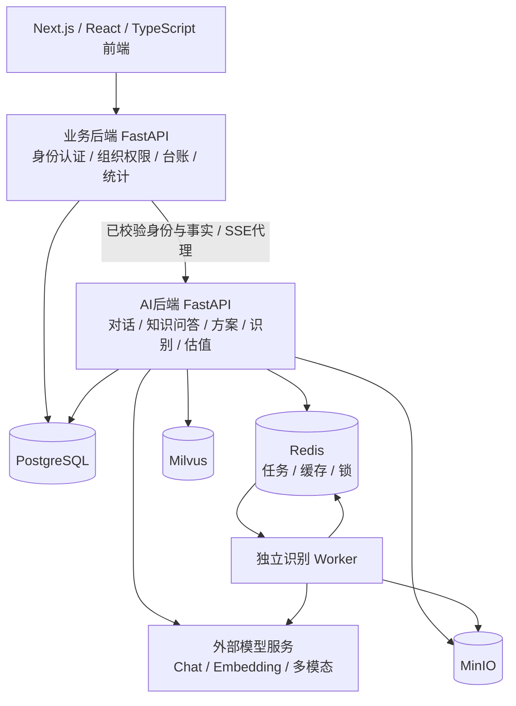
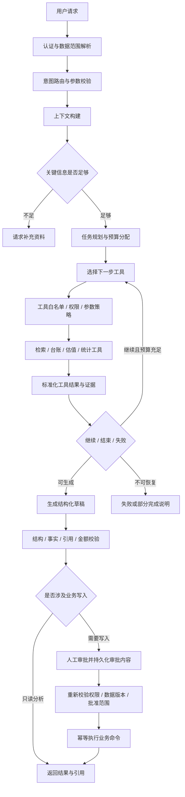

# Agent 应用开发求职材料：国有资产运营智能体平台

> **2026-10-16 目标稿更新**：新增[完整目标项目简历](./Agent开发工程师简历_投递版.md)和[模拟指标与研发验收路线](./Agent目标版量化指标与研发验收路线.md)，作为后续研发蓝图；待落地能力和模拟成绩不视作已有实现。[当前实现存档](./Agent开发工程师简历_当前实现存档.md)保留上一版事实口径，本文旧版投递指引按此更新理解。

> 适用定位：2 年开发经验｜Java / Python｜Agent 应用开发工程师｜普通公办本科。  
> 整理日期：2026-10-15。项目事实以当前仓库代码为依据。本文包含可摘入简历的正文、项目答辩、企业级演进设计和模拟面试题。

> **2026-10-15 表达升级**：直接投递优先使用[精简简历版](./Agent开发工程师简历_投递版.md)；公开简历参考、成熟工程师表达及商业级架构答辩见[进阶版](./Agent项目包装与面试答辩_进阶版.md)。本文保留为代码事实与面试题手册。

> **工程面试补充**：招聘样本映射、并发容量、分层记忆、上下文压缩、Sandbox、LangGraph 多链路、Trace、RAG 跨文档与版本治理，以及 QPS / Recall 等量化口径统一见[工程实战与量化面试指南](./Agent工程实战与量化面试指南.md)。本文第 2 节为早期素材，正式简历以最新投递版为准；示例数字与设计方案不视作实测或上线成果。

## 1. 求职定位：让面试官快速看见你的价值

### 1.1 推荐定位

**Agent 应用开发工程师 / Python 后端开发工程师（AI 应用方向）**。

你的项目优势是：有完整的企业业务场景，能把大模型接入真实台账、组织权限、知识文档和业务流程，并处理流式交互、异步任务、数据口径、结果校验等落地问题。

建议将项目对外命名为：

**国有资产运营智能体平台（AssetOps Agent）**  
副标题：面向多级组织的资产管理、知识检索与智能盘活决策系统。

“资产盘活”需要向非行业面试官解释为：帮助企业判断闲置资产适合出租、转让还是继续自用，并整理相关资料、依据和实施方案。

### 1.2 简历主线

围绕以下五个问题介绍项目，比罗列功能更容易体现专业性：

1. **业务背景**：资产资料分散在台账、合同、附件中，多级组织存在不同的数据可见范围，盘活分析依赖人工查资料与整理方案。
2. **个人职责**：负责 AI 应用及后端核心模块，打通资产事实、知识检索、模型服务、异步识别和业务系统接口。
3. **核心难点**：模型结果如何可信、数据如何不越权、长任务如何不依赖浏览器、流式回答如何完整且可取消。
4. **解决方案**：Grounding、权限过滤、Schema Validation、确定性计算、SSE、任务队列、状态管理与故障恢复。
5. **交付结果**：形成可交互、可追溯、可导出、有明确失败边界的 AI 业务链路，并支撑多级组织统计和资产运营展示。

### 1.3 阅读边界

本文使用两种状态，便于简历与面试材料复用：

| 状态 | 含义 | 推荐用途 |
| --- | --- | --- |
| 当前实现 | 仓库已有实现或可直接定位的机制 | 简历项目经历、实际项目答辩 |
| 企业级演进设计 | 基于现有模块设计的扩展方案 | 架构设计题、项目改进题、后续作品建设 |

当前已有受控 AI 工作流和对话助手，尚未接入自主工具循环、LangGraph 或 MCP。后文会把这部分完整设计出来。职责表述以你的实际参与范围为准；项目周期、个人身份、业务规模和性能数据保留填写位置。

## 2. 可直接摘用的简历正文

以下正文适合整理为 1—2 页简历。第 2.4 节的项目经历是重点，不需要把整份面试手册放进简历。

### 2.1 基本信息

**[姓名]｜Agent 应用开发工程师**  
2 年开发经验｜Java / Python｜[手机号]｜[邮箱]｜[Git 仓库或作品地址]

**教育经历**：[学校名称]｜普通公办本科｜[专业]｜[入学—毕业时间]

**工作经历**：[公司名称]｜[真实岗位名称]｜[起止时间]

不要因为学历普通就在简介里解释或自我评价。用清晰的项目成果、可演示的功能和能深入回答的技术细节建立竞争力。

### 2.2 个人简介

具备 2 年开发经验，使用 Java、Python 开展业务系统与 AI 应用开发。参与国有资产运营平台建设，重点负责智能盘活助手、知识库问答、异步文档识别及业务数据接入。具备将 LLM 与真实业务系统结合的工程实践，关注 Grounding、权限边界、结构化输出、流式交互和任务可靠性，能够围绕业务问题完成接口设计、模型接入与异常处理。

### 2.3 专业技能

- **AI 应用工程**：具备 LLM API 集成、Prompt Engineering、Context Engineering、RAG、Grounding、结构化输出与引用溯源实践；理解 Agent、Workflow、Function Calling 的适用边界。
- **Python 后端**：使用 FastAPI、Pydantic、SQLAlchemy Async、HTTPX、asyncio，具备异步接口、SSE 流式代理、并发控制、任务状态管理和异常映射实践。
- **数据与检索**：使用 PostgreSQL、Redis、Milvus、MinIO；理解向量检索、文档分块、Embedding 适配、元数据过滤与组织数据权限。
- **业务与可靠性**：具备资产台账、审批、组织树、统计口径和异步识别等业务开发经验；实践状态认领、锁所有权校验、失败恢复和确定性金额计算。
- **工程协作**：使用 Git、Docker Compose、Alembic、pytest；能够编写接口契约及关键异常路径测试，配合前端完成联调。
- **Java**：掌握 Java 开发；根据实际经历补充 Spring Boot、MyBatis、JVM、并发编程等技术。当前项目后端采用 Python，不把 Java 技术栈列为本项目已落地架构。

> 完成第 10 节方案的实际开发后，可增加：“具备 LangGraph 状态图编排、Checkpoint、HITL 与 MCP 工具接入实践。”目前适合放在架构设计能力或学习计划中。

### 2.4 项目经历：重点推荐版本

**国有资产运营智能体平台｜核心开发：AI 应用与后端｜[项目时间]**

**项目背景**：面向监管单位、国企集团及下属公司的资产运营场景，建设覆盖资产台账、审批推送、盘活成交、预警和经营驾驶舱的业务平台；针对资料查阅、资产分析和方案编制依赖人工的问题，引入大模型与知识检索能力，为业务人员提供智能盘活辅助。

**技术栈**：Python、FastAPI、Pydantic、SQLAlchemy Async、PostgreSQL、Redis、Milvus、MinIO、HTTPX、LLM 兼容协议；前端采用 Next.js、React、TypeScript、ECharts。

**核心职责与成果**：

1. **构建基于业务事实的智能盘活助手**：由业务网关逐项校验资产访问权限，注入台账事实并隔离用户输入与可信上下文，支持多轮对话和可配置提示词；为回答建立明确的数据依据，限制用户伪造资产事实的输入路径。
2. **打通端到端 SSE 流式链路**：实现模型服务、AI 后台、业务网关到浏览器的增量输出，处理 UTF-8 分片、心跳、终态识别、主动取消与异常中断；用户可以边生成边阅读，失败时保留已生成内容，避免把连接断开误判为生成成功。
3. **建设带权限过滤的 RAG 知识服务**：完成文档解析、分块、Embedding 适配、Milvus 检索及数据库授权复核，向模型提供可访问的有效文档并返回来源引用，为制度查询和方案生成提供证据支撑。
4. **实现结构化盘活方案工作流**：整合资产上下文、知识证据和估值参考，通过 Pydantic 校验模型输出，增加无来源金额与法规引用过滤、输入快照摘要及版本信息；支持基于同一份已生成方案导出 Word，保持页面内容和导出内容一致。
5. **实现异步多模态文档识别链路**：拆分 API 与独立 Worker，使用 Redis 队列、任务状态认领、资产级锁、批次并发和异常重试处理附件识别；将任务执行与浏览器生命周期解耦，支持进度查询、异常提示和未完成任务恢复。
6. **将关键金额判断从模型生成中拆离**：建设确定性的可比案例估值模块，使用 Decimal 统一价格单位、筛选有效样本并计算参考区间，模型负责解释计算结果；样本不足时返回缺少上下文状态，提升金额结果的可解释性和可复算性。
7. **统一多级组织统计与运营展示**：按监管、集团、子公司权限范围汇总真实业务数据，支持组织树视角切换、下属企业排序展示，并通过静默轮询和局部更新处理驾驶舱周期性重绘问题，改善长期展示体验。

**项目结果**：交付资产事实问答、知识检索、盘活方案生成与导出、异步材料识别等核心能力，形成“业务数据—知识证据—AI 分析—结果复核”的辅助决策链路；对越权输入、资料不足、流式中断和任务重启等场景建立明确处理机制。

> 如简历空间有限，保留第 1、2、3、4、5 项；第 6 项用于体现 AI 与业务计算分工，第 7 项用于体现完整业务系统开发能力。不要一次塞满所有技能名称。

### 2.5 更精简的五条版本

- 负责资产盘活 AI 应用与后端集成，基于服务端权限校验和台账事实构建 Grounded Context，支持多轮问答及提示词配置。
- 实现跨服务 SSE 流式输出与 Cancellation Propagation，处理增量解码、心跳、终态校验及异常保留，完善长响应交互。
- 建设 RAG 知识服务，完成文档入库、向量检索、授权复核和 Citation Attribution，为业务问答与盘活方案提供证据。
- 通过 Pydantic Schema Validation、确定性估值和输出后处理约束生成结果，实现可追溯的结构化方案及一致性 Word 导出。
- 设计 Redis 队列与独立 Worker 的异步识别流程，结合任务认领、锁所有权校验、有限重试及恢复机制，提升长任务处理可靠性。

## 3. 项目背景：用业务价值解释为什么需要 Agent

### 3.1 业务痛点

**资料分散**：资产面积、用途、租赁信息在台账中，权证和合同在附件中，制度依据在文档中。业务人员需要在不同页面和文件间切换，完成分析前的资料收集。

**组织层级复杂**：监管单位需要查看集团整体，集团需要查看本级与下属公司，子公司只能查看授权范围。相同问题在不同身份下应返回不同数据。

**方案重复编写**：出租、转让等盘活建议包含相似的材料整理、风险提示和实施步骤，但每项资产的事实、资料完整度和适用依据不同。

**金额口径敏感**：租赁价值、台账价值、市场成交价和评估参考值不是同一个概念。直接让模型自由推断，很容易出现单位错配、周期不明和金额误用。

**长任务体验差**：附件识别和模型分析耗时较长，需要把“立即响应的接口”和“后台执行的任务”分离，同时提供进度和失败反馈。

### 3.2 项目价值

| 业务环节 | 系统做了什么 | 可交付的效果 |
| --- | --- | --- |
| 找资料 | 台账事实接入、知识检索、文档来源展示 | 降低资料收集与跨页面查阅成本 |
| 看资产 | 自然语言咨询、资产匹配、确定性估值参考 | 提供带依据的分析辅助 |
| 写方案 | 结构化生成、缺失项提示、Word 导出 | 形成可继续修改和复核的方案草稿 |
| 录材料 | 异步识别、字段候选、证据页码 | 将人工录入转为候选复核 |
| 管组织 | 多级权限、按授权范围统计 | 同一系统适配监管与企业视角 |
| 查问题 | 明确状态、请求标识、版本与来源 | 为定位和复核提供基础信息 |

这些是系统能力和业务价值描述。节约多少时间、准确率提升多少，需要第 12 节的实际测量支撑。

### 3.3 业务闭环


AI 提供分析和材料辅助；审批、推送等业务写入由既有权限与流程控制。当前对话助手不会自主执行整条业务闭环。

## 4. 当前系统架构与技术选型

### 4.1 实际架构



### 4.2 为什么拆分业务后端与 AI 后端

业务系统负责权威数据和权限裁决，AI 服务负责模型适配、检索和生成。这样可以让权限逻辑留在业务边界内，避免将整个台账直接交给模型，也便于独立管理 AI 的依赖、超时和并发。

**专业表述**：领域边界拆分、服务间契约、模型适配层、业务与推理负载隔离。

这是一种服务拆分架构。当前证据不足以宣称已经建设完整微服务治理平台、服务网格或多地域容灾。

### 4.3 选型答辩表

| 技术 | 在项目中的作用 | 面试时强调的理由与边界 |
| --- | --- | --- |
| FastAPI + asyncio | AI 接口、流式响应、外部服务调用 | 适合 I/O 密集型链路；同步 SDK 仍可能阻塞事件循环 |
| Pydantic | 输入约束、模型输出校验、结构化结果 | 明确服务契约；结构合法不代表业务正确 |
| SQLAlchemy Async + PostgreSQL | 业务数据、AI 元数据、事务 | 关系与权限查询适合关系数据库；长模型请求不应占住数据库事务 |
| Redis | 短期缓存、任务状态、队列与锁 | 当前实现轻量、易集成；可靠消息与多 Worker 仍有演进空间 |
| Milvus | 知识分块向量检索 | 与元数据授权复核配合；向量库不能代替业务权限服务 |
| MinIO | 原始附件、文档存储 | 分离文件内容与结构化元数据，便于后续重解析和来源追溯 |
| HTTPX | 模型兼容协议与流式代理 | 统一连接、超时和取消管理；协议兼容不代表所有供应商行为完全一致 |
| PyMuPDF / pypdf / python-docx | PDF、文本和 Word 处理 | 分离文档解析、视觉识别与结果渲染职责 |
| React + ECharts | AI 交互、驾驶舱与组织视角 | 通过局部更新和稳定状态减少无意义重绘 |
| Docker Compose / Alembic | 开发集成环境、数据库迁移 | 支撑环境复现；当前开发 Compose 不直接等同生产高可用部署 |

## 5. 个人职责：突出系统重点，保持可深入追问

推荐将责任范围组织为“主线 + 支撑”，比“全栈所有模块全部精通”更可信。

**主线职责**：AI 应用后端、业务事实接入、对话与方案编排、知识检索、异步识别、模型结果约束。

**支撑职责**：组织数据权限、业务统计口径、前后端联调、驾驶舱交互问题定位和关键契约测试。

**架构参与**：业务与 AI 服务拆分，模型适配与 Provider 抽象，状态与异常契约设计，后续 Agent 工具化和状态图演进方案。

两年经验最有说服力的表达是：“这条链路我负责到什么程度，出现什么具体问题，我如何定位，改动如何起作用。”可以展示系统视野，但要能把回答落到代码和异常分支。

## 6. 核心 AI 链路与工程设计

### 6.1 对话助手：Grounding 与 Context Engineering

**当前链路**：用户选择资产并提问 → 业务后端逐项验证资产权限 → 注入台账事实 → AI 服务组装提示词、事实和历史 → 模型流式返回 → 网关透传 → 页面增量展示。

设计重点：

- 浏览器只能提供资产 ID 和用户对话，业务事实由服务端查询；请求 Schema 禁止额外字段，历史消息只接受 `user`、`assistant`，不接受伪造的 `system` 消息。
- 资产事实与用户内容分开表述，说明台账字段的业务含义和缺失值语义。
- 区分租赁价格、台账价值与市场成交价；计价周期未知时，不推断年租金或收益率。
- 支持默认、出租、转让等 Markdown 提示词模板读取，并限制路径、符号链接和文件大小。
- 当前限制单次最多 10 项资产、20 条历史消息，并有字符长度上限；前端选取完整历史轮次，避免把中断半成品当作已完成回答带入。

**效果**：回答可以使用本次授权资产的真实信息；输入侧具备事实来源和消息角色边界。

**边界**：这条对话链路当前没有自主选择工具，也没有自动进入知识检索。资料进入提示词并不意味着完成了全面的 Prompt Injection 防护；模型仍需要输出约束和应用层控制。

### 6.2 SSE：Streaming、Cancellation Propagation 与有限预取

事件使用 `status / meta / delta / done / error`，分别表达执行状态、元数据、增量文本、完成和失败。

关键工程点：

1. 模型输出通过 HTTPX 异步流消费，业务网关按字节转发，避免先聚合整段答案再下发。
2. 浏览器使用流式 `TextDecoder`，跨网络块缓存 SSE 行，处理 UTF-8 字符拆分、CRLF 和多行 `data`。
3. 只有收到 `done` 才确认完成；网络 EOF 本身不能证明业务成功。
4. 心跳采用 SSE 注释，等待慢模型时维持连接；心跳不是模型生成进度。
5. 心跳包装只保留一个待取的 `anext` 任务，避免持续提前读取模型输出。
6. 用户取消或连接关闭时，清理 Reader、异步生成器、待处理任务和上游连接；避免遗留无用请求。
7. 中断时保留已生成文字并标记失败；不自动把另一份重试答案拼接到旧答案上。
8. 数据库事务在长时间流式响应前结束，避免回答期间长时间持有事务。

**效果**：具备渐进式阅读、可停止和明确异常终态的流式体验。

**专业边界**：当前是端到端流式传输和有限预取；代理缓冲区、操作系统和供应商仍可能存在缓冲。不能直接宣称拥有完整的跨服务背压控制或模型服务端计费取消保证。

### 6.3 RAG：检索、授权、引用分开治理

**入库链路**：上传文档 → MinIO 保存原文 → 解析文本与结构 → 分块并附加标题、页码等元数据 → Embedding → Milvus 写入 → PostgreSQL 维护文档和分块关系。

**查询链路**：构建查询向量 → 向量候选召回 → 使用数据库复核授权和有效版本 → 相关性过滤 → 组装证据上下文 → 模型回答与引用返回。

权限范围由业务服务构造，包括资产、交易、部门范围及允许访问的公共知识，不能由前端自行声明可信范围。

**实现特点**：

- 已有真实 Embedding 兼容接口适配，也保留本地哈希向量模式；本地哈希用于联调和降级，不能作为高质量语义检索的证明。
- 向量候选经业务数据库过滤后才进入模型上下文，降低未授权文档进入答案的风险。
- 来源返回文档和片段信息，帮助业务人员回看依据。
- 无有效证据时应说明资料不足；通用模型知识与企业文档证据需要明确区分。

**当前待优化**：主要依赖召回后授权过滤，候选上限可能造成“召回结果被过滤完，但授权文档没有机会进入候选”的问题。后续需加入向量侧 ACL 预过滤，并保留返回前的权威复核。

### 6.4 结构化方案：受控 Workflow 与 Output Guardrails

这条链路与自由对话分开：

```text
资产权限校验
  → 构建业务上下文
  → 核心资料完整性检查
  → 授权知识检索 + 估值参考
  → 确定性风险检查
  → 单次模型生成结构化草稿
  → JSON / Pydantic 校验
  → 无来源金额与法规引用过滤
  → 组合正式结果 + 缓存
  → 基于相同结果导出 Word
```

结果包含输入快照摘要、提示词版本、结构版本、知识来源和告警信息。资料不足、权限不足、模型不可用和结果失败使用不同状态表达。

**效果**：方案可以被程序继续处理、渲染和导出；页面与导出文档使用相同生成结果，减少重新生成造成的内容不一致。

**边界**：现有金额和法规过滤包含规则、正则及来源数字匹配。它不能证明所有内容都得到语义支持，也不等于消除幻觉。后续应将金额、单位、周期和证据组成强类型对象，逐项核验。

### 6.5 异步文档识别：Queue + Worker + 状态管理

用户上传材料后由 API 建立任务，后台 Worker 执行 PDF 处理、多模态识别和候选合并，前端查询任务进度。

当前机制包括：

- Redis 队列、任务状态与待处理任务集合；Worker 启动时恢复未完成任务。
- 状态认领使用 Lua 校验，减少同一队列任务被重复并发执行。
- 资产级锁防止冲突操作；释放时核对锁所有者，避免旧任务删除新任务的锁。
- 页面或文件按批次处理；模型调用有进程内并发限制。
- 针对 429、部分服务端错误和瞬时网络异常有限重试，使用指数退避。
- 单批失败可记录告警并保留其他结果；返回字段候选、来源文件、页码和证据，交给业务人员复核。

**效果**：关闭页面不再直接终止后端识别；长任务有独立执行和查询入口。

**当前边界**：Worker 存在单领导执行限制；恢复不是每个批次的持久化断点续跑；任务存在重复处理可能，不能描述为 Exactly-once，也不能声称已支持成熟的多 Worker 水平扩展。

### 6.6 确定性估值：LLM + Domain Engine

金额计算由领域引擎负责，LLM 负责解释。

- 采用可比案例法，按用途、样本状态、金额单位和可比性筛选。
- 排除目标资产自身、重复或无效案例，区分成交、挂牌、评估和参考等来源层级。
- 使用 Decimal 计算，出租统一到 `元/平方米/月`，转让统一到 `元/平方米`。
- 以有效样本的第 25、50、75 百分位形成参考区间；至少满足 3 条样本、2 项不同资产的条件，否则不输出估值数字。
- 明确参考区间和正式评估的差别；启发式置信等级不是统计置信区间。

**效果**：相同输入能够得到可复算的计算结果，并展示样本依据；减少语言模型自行算价或混用金额字段的风险。

当前不是训练得到的估价模型，也没有模型微调或价格预测精度指标。

### 6.7 资产匹配：规则评分与工具化基础

当前自然语言需求主要通过规则解析成筛选条件，再按面积、区域、用途、关键词等因素评分。评分是排序启发式，不是推荐成功概率。

已有 `search_assets` 工具适配雏形，但还未接入自主工具循环。后续接入 Function Calling 时，应保留面积、区域等硬约束，并将权限上下文由服务端注入，避免模型自行填写用户身份。

### 6.8 驾驶舱：权限口径与稳定渲染

统计范围由用户组织和被允许选择的组织决定。监管视角汇总国企集团及其下属公司；集团视角查看本级和子树；下属公司访问自身授权范围。不能为了图表分布把集团直属资产任意分摊到子公司。

周期性“刷新一样”的体验需要区分网络请求与页面重建：轮询可以保留，但无变化的数据不应该触发整屏销毁、动画重放和滚动复位。当前工作区已有静默轮询、业务快照复用与分区更新相关改动。

**面试表述**：“我从数据更新机制和渲染生命周期两侧排查，保留定时拉取，把视觉刷新控制到实际变化的区域。”最近驾驶舱改动的最终视觉验收由用户执行，不将其写成已取得量化性能收益。

## 7. 技术难点：按照‘问题—行动—效果’回答

### 难点一：模型会理解错业务字段，导致回答看似合理但金额错误

**背景**：台账中的 `evaluation_price` 实际表示租赁价格；字段英文名容易让人或模型联想到评估价。租赁周期也不一定完整。

**我的行动**：在业务上下文中补充中文业务含义与状态标签，明确租赁价格、台账价值、成交价之间的差别；缺失字段按未知处理；估值链路通过领域引擎统一单位。

**结果**：模型输入的金额口径更明确，金额计算具备独立、可复算的路径，资料不足可以反馈补充项。

**术语**：Semantic Mapping、Grounding、Domain Invariant、Deterministic Calculation。

### 难点二：客户端不能成为权限和资产事实的裁判

**背景**：如果前端直接传资产 JSON，用户可以修改金额、归属公司，或拼接无权访问的资产。

**我的行动**：前端提交资产 ID；业务网关逐项检查访问权限，再生成事实上下文；Pydantic 禁止额外字段和历史中的 `system` 角色。知识检索范围同样由服务端计算。

**结果**：建立统一的可信事实入口，阻断通过常规请求字段冒充服务端事实和系统消息的路径。

**术语**：Trust Boundary、Server-side Authorization、Least Privilege、Schema Validation。

### 难点三：SSE 正常关闭和生成成功不是同一件事

**背景**：上游可能在输出一半后断开，网络字节块也不一定与 SSE 事件边界对齐。

**我的行动**：定义明确完成事件；浏览器用流式解码和跨块缓冲解析；链路中断显示异常并保留文字；取消向上游连接和异步生成器传播。

**结果**：前端可以区分成功、中断和停止，避免半成品被当作完整回答，且减少取消后的无用任务。

**术语**：Application-level Terminal Event、Incremental Decoding、Cancellation Propagation、Resource Cleanup。

### 难点四：识别任务耗时长，页面不能承担执行责任

**背景**：多文件、多页识别可能超过普通接口和浏览器等待时间，模型服务还可能限流。

**我的行动**：拆分提交与执行；使用独立 Worker、任务状态、批次处理、并发限制和瞬时失败重试；保留来源页码及部分成功结果。

**结果**：任务可在后台执行和查询，单批失败不会必然抹掉所有已成功结果，为人工复核提供依据。

**术语**：Asynchronous Job、Producer–Consumer、Bounded Concurrency、Exponential Backoff、Partial Failure。

### 难点五：锁能防并发，但处理不当也会误伤新任务

**背景**：旧任务持有的锁过期后，新任务可能已经取得同一个锁；旧任务结束时直接删除，会破坏新任务保护。

**我的行动**：锁值保存任务所有者，释放时用 Lua 原子比较所有者再删除；任务入队后的执行状态也进行认领校验。

**结果**：降低旧任务误删新锁和重复队列项同时执行的风险。

**追问边界**：锁 TTL 不自动提供严格互斥；长任务需要续租、失租处理和 fencing 等进一步机制。当前任务恢复仍允许重新处理。

### 难点六：RAG 有检索不等于有依据，更不等于有权限

**背景**：高相似度文档可能无权访问，也可能过期或无法支持当前结论。

**我的行动**：授权范围从业务后端取得，候选结果经数据库复核有效状态与权限，返回引用和来源；无合适证据时明确资料不足。

**结果**：模型上下文与最终来源有业务权限约束，用户有机会复核依据。

**追问边界**：引用存在不等于引用正确；召回后过滤还存在授权文档召回不足的问题，需要预过滤与评测。

### 难点七：模型结构正确，也可能在业务上错误

**背景**：JSON 可以解析，但可能缺少关键项，或者出现无来源金额和法规。

**我的行动**：用 Pydantic 定义结构契约，补充核心资料检查、来源规则与失败状态；估值数字来自计算模块；方案保存输入摘要与版本。

**结果**：异常结果不能轻易伪装成完整成功，方案具备进一步校验和追溯的基础。

**术语**：Structured Output、Schema Validation、Output Guardrails、Provenance、Fail-closed。

### 难点八：导出时再次调用模型，会生成第二份不同方案

**我的行动**：将已生成方案按用户和方案标识缓存，导出读取同一份结构化结果；过期明确提示重新生成，不能悄悄拿另一份内容替换。

**结果**：页面与 Word 文档在有效期内保持内容来源一致。

**追问边界**：Redis 短期缓存不是长期版本档案。正式商用应补充数据库版本、不可变文档快照和授权审计。

### 难点九：组织树切换很容易让统计越界或重复

**我的行动**：将组织视角与可见范围结合，在后端统一计算本级、子树和所选下属组织范围；明确集团直属与子公司资产归属，前端不自行拼接多个口径求和。

**结果**：监管、集团和子公司视角使用相同的组织规则，图表与台账可以按相同条件对账。

**术语**：Hierarchical Data Scope、Metric Consistency、Authoritative Data Source。

### 难点十：模型长调用占着业务事务，会放大连接池压力

**我的行动**：在流式响应前完成权限读取并结束事务，后续仅保持模型和 HTTP 流的生命周期；将耗时任务交给独立执行链路。

**结果**：避免业务事务跨越长时间生成阶段，为数据库连接资源及时释放创造条件。

**术语**：Transaction Boundary、Connection Pool、I/O-bound Workload、Lifecycle Management。

## 8. 如何写‘优化了什么、达到什么效果’

### 8.1 不需要虚构百分比也能体现成果

| 弱表达 | 推荐表达 |
| --- | --- |
| 接入了大模型 | 接入授权资产事实和模型流式接口，完成可多轮交互、可取消、可异常反馈的盘活问答链路 |
| 做了知识库 | 完成文档入库、检索、授权复核与来源展示，让方案可以关联可复核证据 |
| 优化了模型准确率 | 对金额单位、资料缺失、结构和来源分别设约束，减少模型自由推断关键事实的空间 |
| 做了 Redis 队列 | 将识别提交与后台执行分离，支持状态查询、并发限制、有限重试和未完成任务恢复 |
| 做了数据大屏 | 统一组织子树和台账统计口径，支持监管与企业视角，并处理周期性整屏重绘问题 |
| 性能很好 | 流式输出避免整段等待；生成前结束事务；识别任务独立执行。具体延迟与吞吐由压测报告提供 |

### 8.2 成果表达公式

**针对什么问题 + 采用什么机制 + 交付什么行为或可测效果**。

示例：“针对长文档识别依赖同步请求的问题，拆分 API 与 Worker，通过队列、状态认领和批次处理实现后台执行与进度查询，用户关闭页面后任务仍可继续处理。”

有测量数据后再升级为：“在相同材料、模型与并发条件下，批次识别耗时 P95 从 `[基线]` 降至 `[结果]`，重试后任务完成率达到 `[实测]`。”

### 8.3 不要混用业务与模型指标

- “已识别字段数”不等于“字段准确率”，必须有人工标注的正确值。
- “返回答案”不等于“任务成功”，需要明确验收条件。
- “引用数量”不等于“依据充分”，要核验引用是否支持具体结论。
- “规则置信分”不等于“正确概率”。
- 演示数据中的资产和成交笔数不能作为生产经营成果。

## 9. 专有名词：放在正确的位置才显得专业

| 术语 | 中文含义 | 结合项目怎么讲 |
| --- | --- | --- |
| Grounding | 基于外部事实生成 | 台账和知识证据为回答提供依据 |
| Context Engineering | 上下文工程 | 决定送什么事实、多少历史、哪些证据，以及如何标注可信边界 |
| RAG | 检索增强生成 | 从授权文档中检索片段，再用于回答和方案 |
| Provenance | 来源与处理链路 | 记录原文、片段、页码、输入快照和版本 |
| Citation Attribution | 引用归属 | 将具体结论与支持它的证据对应 |
| Schema Validation | 结构契约校验 | Pydantic 检查输入、输出类型和必填字段 |
| Guardrails | 应用约束机制 | 权限、数据校验、计算规则、输出检查共同约束结果 |
| HITL | 人在回路 | 识别候选需复核；未来高风险工具执行前审批 |
| Tool Calling | 工具调用 | 模型提出工具名与参数，应用校验后执行 |
| Agentic Loop | 智能体工具循环 | 观察结果后继续决策，受步数、时间和预算限制；当前属于演进项 |
| State Machine | 状态机 | 对任务阶段和可执行转换建立明确约束 |
| Checkpoint | 执行检查点 | 保存可恢复状态；当前不是 LangGraph 持久化恢复 |
| Idempotency | 幂等 | 重试相同业务操作不产生重复副作用；当前有局部防重，不是全链路幂等保证 |
| Backpressure | 背压 | 下游变慢时限制上游产出和缓冲；当前已有限制预取，仍需全链路设计 |
| Circuit Breaker | 熔断 | 持续异常时快速停止请求，避免扩大故障；属于演进项 |
| Observability | 可观测性 | 从日志、指标、链路判断系统状态；当前有部分审计和请求标识，统一体系待建设 |
| SLI / SLO | 服务指标 / 服务目标 | 先定义成功率、延迟等测量口径，再制定目标 |
| Evaluation Harness | 评测执行框架 | 固定数据集、版本、评估器和报告，比较不同方案 |
| ACL-aware Retrieval | 感知权限的检索 | 检索阶段缩小授权候选，返回前再做权威复核 |
| MCP | 模型上下文协议 | 为工具与资源接入提供标准化接口；当前属于演进项 |

## 10. 企业级 Agent 演进设计

> 本节是可落地的目标架构，用于系统设计面试与后续开发。以下节点图、工具循环、MCP、检查点和监控选型尚未整体落入当前仓库。

### 10.1 从‘受控工作流’演进到‘有限自主 Agent’

目标不是让模型接管所有逻辑，而是把确定性步骤与模型决策结合：

- 权限、金额、统计、状态变更由程序控制。
- 用户意图识别、检索策略选择、结果解释由模型辅助。
- 已知流程优先使用确定性工作流；需要根据工具返回继续探索的问题，才进入有限工具循环。
- 出租、转让、推送等产生业务副作用的操作，先生成草稿，经过明确审批后再执行。

**推荐架构**：单一业务 Agent + 显式状态图 + 领域工具。先建立可靠边界，再判断是否需要多 Agent。多个 Prompt 或多个节点不必然构成多 Agent。

### 10.2 目标状态图



### 10.3 LangGraph 状态设计

可以将现有资产 Provider、知识 Provider、估值引擎包装为图节点，复用业务逻辑，不在迁移编排时重写领域规则。

```python
# 目标设计示意，不是当前仓库接口，也不是可直接运行的 LangGraph 配置。
class AssetAgentState(TypedDict):
    run_id: str
    thread_id: str
    principal_ref: str
    scope_version: str
    intent: str
    messages: list
    selected_asset_ids: list[int]
    asset_snapshot_hash: str
    evidence: list
    tool_results: list
    pending_actions: list
    approved_action_hash: str | None
    remaining_steps: int
    remaining_budget: dict
    deadline: str
    status: str
    errors: list
```

关键决策：

1. `thread_id` 对应会话，`run_id` 对应一次执行，工具调用再有独立 `tool_call_id`；服务端验证会话归属。
2. checkpoint 中保存身份引用和授权范围版本，不保存可直接复用的长期明文令牌。
3. 只在消息、证据等集合上使用合适的 reducer，依据消息 ID、证据 ID 去重；标量状态不能无脑相加。
4. 并行节点写不同字段，或使用明确合并策略，避免并发覆盖。
5. 使用 PostgreSQL 等持久化检查点；记录图版本和状态结构版本，处理发布后的恢复兼容。
6. checkpoint 恢复前重新认证、检查授权与业务版本；保存过的权限不代表现在仍有效。
7. 检查点降低重算成本，不自动保证工具副作用只执行一次。业务写操作必须单独幂等。

**为什么选择 LangGraph**：目标场景需要显式分支、暂停审批、检查点和恢复；普通的单轮请求继续使用轻量服务函数即可。框架的价值取决于流程复杂度。

### 10.4 工具契约：把模型建议变成受控调用

| 工具 | 输入示例 | 输出 | 策略 |
| --- | --- | --- | --- |
| `get_asset_facts` | 授权范围内资产 ID | 当前事实、版本、来源 | 每次执行重新鉴权 |
| `search_knowledge` | 查询、文档类别、TopK | 授权证据片段和引用 | ACL 预过滤 + 返回复核 |
| `match_assets` | 需求与硬条件 | 候选、匹配项、不满足项 | 硬约束优先，评分只做排序 |
| `calculate_valuation` | 资产、用途、计价条件 | 可比案例与参考区间 | 程序计算，不接受模型自填最终金额 |
| `query_asset_metrics` | 组织范围、时间、指标枚举 | 聚合值、单位、口径 | 参数化查询，不暴露任意 SQL |
| `draft_activation_plan` | 事实快照、证据、需求 | 结构化草稿 | Schema 与事实校验 |
| `create_activation_draft` | 草稿内容及来源版本 | 草稿 ID、版本 | 写操作，审批与幂等 |
| `submit_approved_push` | 已审批草稿 ID、版本 | 推送任务 ID、状态 | 精确绑定审批内容、强制重验 |

工具参数中的用户、租户和权限不交给模型填写。工具结果使用统一结构：`status / data / sources / warnings / error_code / retryable`，区分空结果、无权限、输入不足和服务故障。

禁止默认提供任意文件访问、任意 Shell、任意 URL 请求或任意 SQL 工具。

### 10.5 有限工具循环伪代码

```python
# 设计示意：展示边界，不是现有实现。
async def run_agent(request, trusted_context):
    state = await load_authorized_state(request, trusted_context)
    budget = Budget(max_steps=6, max_tool_calls=8, deadline_seconds=90)

    while budget.can_continue():
        decision = await decide_next_action(state, budget)
        if decision.kind == "final":
            return await validate_final_answer(decision, state)

        tool = registry.require_allowlisted(decision.tool_name)
        arguments = tool.input_schema.validate(decision.arguments)
        authorization = await authorize_now(tool, arguments, trusted_context)
        budget.reserve(tool)

        if tool.has_side_effect:
            action = await persist_pending_action(tool, arguments, state)
            # 实际图执行应持久化暂停；恢复后重新校验审批、权限、参数哈希与数据版本。
            approval = await require_approval_for(action)
            result = await execute_approved_idempotently(action, approval)
        else:
            result = await execute_with_timeout(tool, arguments, authorization)

        state = merge_and_sanitize_result(state, result)
        await checkpoint(state)

    return build_budget_exhausted_result(state)
```

步数、调用数和时间仅为设计示例，不是压测结论。实际还要限制输入输出 Token、单工具结果体积、单次成本、重复调用模式和并行度。

终止原因必须可观察：正常完成、需要资料、需要审批、预算不足、工具失败、用户取消。不要让模型自行决定是否还有无限预算。

### 10.6 MCP 接入方案

将资产查询、知识检索、统计和文档生成作为受控服务，通过 MCP 工具或资源接口供 Agent 使用。Agent 是使用协议的宿主，MCP Client 管理连接，MCP Server 封装业务能力。

**与 Function Calling 的区别**：Function Calling 负责模型如何提出工具名和参数；MCP 负责应用如何以标准方式发现、连接和访问工具或资源。二者可以协同，MCP 不替你完成任务规划、权限判断和业务幂等。

落地要点：

- 按业务域隔离工具服务，避免一个服务拥有全系统读写权限。
- 工具清单由服务端审核，工具描述和外部资源仍视为可能不可信。
- 使用符合所选传输和协议版本的身份认证；按受众验证凭据，避免把用户令牌无条件透传到不同下游。
- 每次调用按当前身份和组织范围验证，不因 MCP 已建立连接就省略业务授权。
- 写操作执行人工审批、操作内容哈希绑定和幂等控制。
- 固定协议与依赖版本，增加工具契约兼容测试；上线前核对当时官方规范。

### 10.7 记忆设计：Memory 不等于全部聊天记录

| 类型 | 内容 | 存储与约束 |
| --- | --- | --- |
| 短期上下文 | 当前问题、最近完整轮次 | Token 预算内裁剪 |
| 执行状态 | 已检索证据、工具结果、待批准操作 | checkpoint，带状态版本 |
| 会话摘要 | 已确认需求、尚缺资料 | 摘要附来源；关键事实重新查询 |
| 用户偏好 | 输出格式、常用关注项 | 用户确认，可删除，按账号隔离 |
| 业务事实 | 资产归属、金额、审批状态 | 始终从权威系统读取，不能由记忆覆盖 |

企业数据不随意写入跨用户长期记忆；会话删除、留存策略和权限变更需要覆盖摘要、索引和附件。

### 10.8 RAG 升级：Hybrid Search + Rerank + Evidence Packing

建议演进链路：

```text
授权范围解析
  → 查询意图识别与必要改写
  → BM25 与 Dense Retrieval 并行召回
  → RRF 合并候选
  → ACL 权威复核、版本和重复过滤
  → Reranker 重排序
  → 根据 Token 预算组织证据
  → 逐结论生成并绑定引用
  → 事实和引用检查
```

注意事项：

- 专有名词、公司全称、文件号和资产编码通常需要词法精确匹配，不能只依赖语义向量。
- RRF 用排名融合候选，避免直接比较不同检索器的原始分数；它不等于一定提高最终质量。
- 重排序增加延迟，必须比较质量收益与 TTFT，必要时只对复杂问题启用。
- 不同 Embedding 模型的向量不能混在一个不兼容空间里直接比较；记录模型、维度和预处理版本。
- 文档更新采用新版本构建、验证、切换和旧版清理，避免“先删后写”造成检索空窗。
- 为多租户预留可信租户标识；部门权限过滤不自动等于已完成成熟的租户隔离。

### 10.9 可靠性升级：从局部防重到任务闭环

**消息可靠性**：持久化任务记录，使用 Outbox 解决业务状态与消息发布之间的双写问题；消息投递允许至少一次，消费者通过业务幂等保证重复处理不重复生效。

**任务并发**：从单领导 Worker 演进到逐任务 lease、heartbeat 和超时回收。每个任务或写入使用递增 fencing token，由写入端拒绝旧持有者结果。

**重试治理**：只重试瞬时故障；区分 429、5xx、超时、鉴权失败、输入失败；指数退避增加 jitter，设置最大次数、累计时间和死信队列，避免所有 Worker 同时重试。

**幂等设计**：读取不需要副作用幂等键；创建草稿、推送等写操作使用服务端幂等键和唯一约束，键中绑定业务操作及版本。数据库写成功但响应丢失时，应查询已有结果。

**副作用审批**：人工批准的是明确内容和版本。恢复后内容或权限变化，原批准不能直接重用。

### 10.10 性能与成本：先识别瓶颈，再选优化

| 瓶颈 | 设计方案 | 必须防止的问题 |
| --- | --- | --- |
| 同步 SDK 阻塞事件循环 | 原生异步客户端或有界线程池 | 不受控线程增长、连接泄漏 |
| 多副本叠加模型并发 | 跨实例配额、租户公平排队 | 单进程 Semaphore 不能限制全局 |
| 供应商 RPM / TPM 限制 | 请求与 Token 双预算、预留与结算 | 只限制 QPS 仍可能超过 Token 配额 |
| 长历史和大文档 | Token 预算、摘要、分层检索 | 摘要丢失事实、关键证据被裁剪 |
| 简单问题调用昂贵模型 | 基于任务难度和质量基线的模型路由 | 低成本模型在关键问题上降质 |
| 重复检索与生成 | 带权限与版本的缓存、Single-flight | 跨组织泄露、脏缓存和误共享 |
| 模型故障拖垮接口 | 独立超时、Bulkhead、熔断和明确降级 | 降级不能编造“完成”状态 |

取消连接可减少应用侧资源占用，但供应商是否停止生成、是否减少计费需要单独验证，不能直接推断。

### 10.11 可观测性与发布

目标链路统一关联 `request_id / trace_id / run_id / tool_call_id`，记录节点耗时、模型版本、提示词版本、Token 用量、结束原因、检索数量和工具结果状态。

- 业务指标：有效方案数、人工采纳率、字段复核耗时、任务完成率。
- 质量指标：答案正确性、依据覆盖、引用准确、越权事件、错误写入。
- 系统指标：TTFT、端到端延迟、排队时间、失败率、重试率、活跃任务数。
- 成本指标：单任务输入输出 Token、费用、缓存命中与模型路由占比。

可以选 OpenTelemetry 关联服务链路，Prometheus / Grafana 记录指标，Langfuse 或 LangSmith 管理模型运行与评测。具体选型需结合部署与数据合规条件，不必同时引入全部平台。

日志不记录原始密钥、长期身份凭据或完整敏感合同；提示词和模型输出按分类、脱敏、授权和留存策略管理。

发布流程建议：固定版本 → 离线回归 → 小范围灰度 → 观察质量与系统指标 → 扩大流量；出问题按模型、提示词、检索配置和代码分别回滚。

## 11. 当前实现与企业级目标对照

| 能力 | 当前实现 | 企业级补齐方向 |
| --- | --- | --- |
| 对话 | 事实注入、多轮、提示词模板、SSE | Token 感知上下文、会话持久化与质量评测 |
| 工具循环 | 工具适配雏形；对话未自主调用 | 白名单、预算、循环终止、工具追踪 |
| 编排 | Python 领域服务与受控工作流 | LangGraph 状态图、检查点、持久暂停 |
| MCP | 未接入 | 受控工具服务、认证、契约版本 |
| RAG | 文档解析、向量检索、授权复核、引用 | ACL 预过滤、混合检索、重排序、索引版本 |
| Embedding | 本地哈希与真实接口适配 | 明确部署模型、质量评测与重建策略 |
| 估值 | 可比案例、Decimal、样本阈值 | 样本质量评估、领域校验和效果跟踪 |
| 输出治理 | Schema、来源规则、失败状态 | 逐字段证据绑定、语义事实核验 |
| 文档识别 | 队列、独立 Worker、分批与恢复 | 多 Worker lease、幂等提交、DLQ、批次检查点 |
| 并发 | 进程内模型 Semaphore | 跨实例 RPM / TPM / 成本配额 |
| 审计 | 部分审计、请求标识和业务来源 | 全链路 trace、质量与成本统一面板 |
| 数据权限 | 组织范围、服务端鉴权 | 系统化越权回归、租户隔离与权限变更传播 |
| 部署 | Compose 集成环境与迁移 | 生产镜像、健康检查、优雅停止、备份与容灾演练 |

不要将“客户提到三级”直接写成已完成等保三级认证。是否通过认证，需要正式材料支撑。

## 12. 评测与量化成果：把结果写成经得起追问的数据

### 12.1 评测集如何建设

建议从脱敏业务问题中建立首批约 100—200 条样例；这是建设建议，不是当前完成数量。

样例覆盖：

- 单资产事实问答：面积、状态、归属和缺失字段。
- 多资产对比：不能把 A 资产金额归给 B。
- 制度问答：有依据、无依据、过期文档、相似但不适用依据。
- 组织权限：监管、集团、子公司交叉查询及越权 ID。
- 估值：周期不明、单位转换、重复样本、样本不足。
- 识别：扫描件、多页、模糊材料、字段冲突和部分失败。
- 流式异常：连接中断、取消、超长输出、缺少完成事件。
- 工具演进：非法参数、重复调用、超预算、工具超时、未批准写入。

每条样例包含：问题、身份范围、资料版本、预期事实、允许引用、预期状态、评分准则。划分开发集与保留集，避免只针对已知问题修改提示词。

### 12.2 指标定义

| 指标 | 定义 / 作用 | 注意事项 |
| --- | --- | --- |
| Recall@K | 标注相关证据中，被 TopK 召回的比例 | 依赖完整相关性标注 |
| MRR | 第一个相关结果排名倒数的均值 | 适合看首个有用证据的位置 |
| nDCG@K | 按相关程度和排名折扣衡量排序 | 需要分级相关性标注 |
| 引用准确率 | 检查的引用中，真正支持对应结论的比例 | 不能只看文档是否存在 |
| 关键事实正确率 | 核验事实中，与权威数据一致的比例 | 金额、单位、周期一起核验 |
| 任务成功率 | 满足事先验收准则的任务 / 有效任务 | 明确失败、拒答与部分完成如何计入 |
| 字段准确率 | 识别字段中正确字段的比例 | 分字段类型与样本难度统计 |
| 结构通过率 | 通过 Schema 校验的输出 / 输出总数 | 不代替语义正确率 |
| 越权用例通过率 | 被正确拦截的越权用例 / 越权用例总数 | 不能据有限样本声称绝无泄漏 |
| TTFT | 约定起点到首个答案文本的时间 | 不把 status / 心跳当作首字 |
| 端到端延迟 | 请求开始到业务成功终态 | 分别报告成功与失败，避免幸存者偏差 |
| 每成功任务成本 | 全部相关调用费用 / 成功任务数 | 含失败和重试成本 |

### 12.3 对照实验

固定模型、数据版本、权限身份、部署资源、并发和网络条件，分别对比：

1. 基础提示词 vs 事实接入与字段语义。
2. 纯向量检索 vs 混合检索 vs 加重排序。
3. 完整历史 vs Token 预算与摘要。
4. 同步识别 vs 队列化及不同批次并发。
5. 优化前后的驾驶舱渲染频次和滚动连续性。

报告样本数、失败样例、P50 / P95、费用以及质量变化。多次运行观察随机波动；LLM-as-a-Judge 只能辅助，需要人工校准，不能只让同一个模型给自己打高分。

### 12.4 可填入简历的量化模板

> 下面全是占位模板，不是项目实测结果；完成测量后替换。

- 在 `[N]` 条脱敏业务问题上，将关键事实正确率从 `[A]` 提升至 `[B]`，同时记录拒答率和主要失败类型。
- 在相同语料与模型条件下，混合检索使 Recall@5 从 `[A]` 达到 `[B]`，端到端 P95 增加 `[C]`，据此决定是否启用重排序。
- 在 `[并发]`、`[文档页数分布]` 条件下，识别任务 P95 为 `[耗时]`，任务完成率为 `[比例]`；重启恢复用例覆盖 `[范围]`。
- 通过上下文裁剪与缓存，将每成功任务平均 Token 从 `[A]` 调整至 `[B]`，质量保留集得分变化 `[C]`。
- 在 `[N]` 条越权回归中，成功拦截 `[M]` 条，并对发现的问题增加修复用例。

## 13. Agent 开发模拟面试题与回答

这些问题按本项目的技术与企业 AI 应用能力组织，不声称来自实时招聘统计。标注“当前实践”的可直接结合代码作答；“设计题”应使用未来式或方案式表达。

### A. 项目与 Agent 架构

**1. 你这个项目为什么叫 Agent？和普通聊天机器人有什么区别？**

参考回答：我主要解决模型如何使用真实业务事实、知识证据和领域计算的问题。当前对话助手是带上下文的多轮咨询，方案生成是程序编排的受控工作流；自主工具循环属于下一阶段。我会按自主程度区分 Chat、Workflow 和 Agent，而不是把所有模型接口都叫全自主智能体。

追问准备：讲清两条实际链路，以及后续哪个步骤需要模型自主决策。

**2. 你在项目里具体负责什么？**

参考回答：重点是 AI 应用与业务后端集成，包括授权资产事实接入、SSE、多轮上下文、知识检索、结构化方案和异步识别。我也参与组织统计与驾驶舱联调。我的主线是让生成能力进入业务边界，并处理资料不足、模型中断和任务失败。

追问准备：选择一条最熟悉链路，从请求 Schema 讲到异常清理，不要只讲目录。

**3. 为什么不用一个大 Prompt 完成所有功能？**

参考回答：权限、金额、业务状态需要确定性规则，大 Prompt 很难保证这些约束。我把领域计算、检索、生成和结果验证拆开，模型只承担适合语言理解与表达的部分。这样更容易测试，也便于定位问题属于数据、检索还是生成。

**4. 什么时候选择 Workflow，什么时候选择 Agent？**

参考回答：步骤和分支可以预先描述的审批材料生成适合 Workflow。用户需求开放、需要根据工具结果继续探索时适合有限 Agent。选择依据是问题的不确定性、失败成本和可审计要求，不是框架热度。

**5. 为什么引入 LangGraph？直接写 Python 不行吗？【设计题】**

参考回答：目前 Python 服务能承载固定流程。需要持久暂停、人工批准、分支恢复和节点级状态时，LangGraph 的状态图与检查点更合适。引入时复用已有 Provider，先迁移一个复杂流程，通过恢复用例验证收益。

**6. 为什么不一开始用多 Agent？【设计题】**

参考回答：当前问题主要是领域边界和权限控制，单 Agent 加领域工具更容易约束。多 Agent 增加上下文传递、协调成本和故障组合，只有当任务确实可独立分解、并行收益可测且职责边界稳定时才考虑。

**7. 如何防止工具循环无限执行？【设计题】**

参考回答：应用层设置步数、工具次数、Token、费用、总时限和单工具结果大小，识别重复参数调用及无新增信息。预算耗尽时返回已获得的信息和未完成原因，不能继续让模型自行规划。

**8. Function Calling 和 MCP 有什么区别？【设计题】**

参考回答：前者是模型输出工具调用意图和参数的机制，后者是应用连接工具和资源的标准接口。二者解决不同边界，可以结合；真正执行仍在应用侧，权限、参数、审批和幂等都需要自己设计。

### B. RAG 与模型可信性

**9. 你的 RAG 完整流程是什么？**

参考回答：文档存原文和元数据，解析、分块并生成向量；查询时召回候选，用数据库复核文档有效状态和授权范围，再组织上下文生成答案并返回来源。当前需要改善召回后过滤导致的授权文档召回不足。

**10. RAG 有引用，为什么仍可能答错？**

参考回答：引用可能只是相关，不能支持具体结论；也可能遗漏前提、引用旧版本或混淆资产。我会把事实正确、引用支持和权限正确分别评测，后续增加逐结论证据绑定，不能把“附了来源”当作解决幻觉。

**11. 分块长度如何选择？**

参考回答：先按标题、段落、条款等结构切分，再设长度与必要重叠。过短缺上下文，过长混入无关内容。合同和制度的分块策略应不同，通过检索与答案评测确定，不能直接说某个长度对所有资料最优。

**12. 为什么需要 Hybrid Search？【设计题】**

参考回答：语义向量善于表达相近含义，资产编码、公司全称和文件号需要精确匹配。可以用 BM25 和向量并行召回，通过 RRF 融合，再加重排序；是否启用由质量和延迟对照决定。

**13. 向量检索选余弦、内积还是 L2？**

参考回答：要依据 Embedding 模型训练和推荐方式、是否归一化、索引支持情况选择。归一化后部分度量的排序有关联，但未归一化时不能直接等价。检索分数也不能直接解释为答案正确概率。

**14. Embedding 模型更换怎么办？【设计题】**

参考回答：记录模型、维度、分块和预处理版本，在新集合中重建向量，跑回归后切换读取版本。不能把新旧空间的向量直接混用；保留回滚和后台清理机制。

**15. 怎样避免跨公司知识泄露？**

参考回答：身份和范围由服务端构造，授权文档复核在上下文进入模型前完成。后续增加检索侧 ACL 预过滤，并对缓存、会话、引用下载和权限变更一起做隔离。Prompt 中写“不泄露”不能代替权限控制。

**16. 用户说‘忽略以上规则’，怎么防？**

参考回答：把用户文本、文档和工具结果当作数据，权限和工具白名单留在程序侧；不允许用户伪造系统角色或可信事实。模型输出仍需校验，高风险写操作审批。仅用分隔符不能保证消除 Prompt Injection。

**17. 温度设为 0 就能解决幻觉吗？**

参考回答：不能。温度影响采样，不能补齐缺失事实，也不能修正错误检索。需要事实来源、确定性计算、输出校验、资料不足状态和评测；低温度也不代表所有供应商输出严格可复现。

**18. 为什么不用模型自己算价格？**

参考回答：金额需要明确来源、单位、周期和公式。当前使用 Decimal 和可比案例引擎计算，模型只解释输入与结果。样本不足就不报估值数字，避免语言能力替代领域规则。

### C. Streaming 与 Python 工程

**19. SSE 为什么会‘最后一次性出来’？**

参考回答：逐层检查模型是否真在流式返回、HTTP 客户端是否聚合、代理是否缓冲、日志中间件是否消费完整响应，以及前端是否等结束后才更新。当前链路按块传递，并设置适合流式的响应头；生产代理还需要单独验证。

**20. 网络 read 一次就是一个 SSE 事件吗？**

参考回答：不是。一个字符或事件可能跨块，多个事件也可能在同一块。前端需要流式解码与残余缓冲，按 SSE 行和空行边界组装事件，再解析 JSON。

**21. 用户点停止后，后端怎么停止？**

参考回答：浏览器 AbortController 取消请求，服务端在断开或取消时清理响应生成器、待处理任务和上游 HTTP 连接。要验证真正释放，而不是只改按钮状态；供应商侧停止生成和计费行为还要另测。

**22. 为什么必须有 done 事件？**

参考回答：网络 EOF 只能说明连接结束，无法区分成功与半途断开。业务终态独立表达完成，前端没有收到就按中断处理，并保留已收到文本。

**23. async 函数里面用了同步 SDK，会怎么样？**

参考回答：同步网络或 CPU 工作仍会阻塞事件循环。当前同步 Embedding、Milvus 调用是优化点，可以换异步接口或用有界线程池隔离。CPU 密集的解析再考虑进程，不靠增加 await 解决。

**24. asyncio.Semaphore 能控制集群并发吗？**

参考回答：只能控制当前进程。部署多个进程后总并发会叠加。要结合跨实例配额、排队与 RPM / TPM 限制；单纯控制请求数也无法约束不同长度请求的 Token 消耗。

**25. 为什么不让数据库事务覆盖整个模型调用？**

参考回答：模型输出可能很慢，长事务会占连接并延长锁或快照生命周期。先完成授权和数据读取，再结束事务；模型生成用事实快照，涉及真正写入时重新检查业务版本。

**26. 如何压测流式接口？【设计题】**

参考回答：记录首个答案文本时间、事件间隔、终态、端到端延迟、断流和取消释放，固定并发、输出长度与模型条件。HTTP 200 不能当作成功，因为业务错误可能在 SSE 事件里。

### D. 队列、状态与分布式可靠性

**27. 你的识别任务怎么保证不因关页面丢失？**

参考回答：任务执行在独立 Worker，页面只提交和查询。队列、状态和待处理集合在 Redis，Worker 恢复未完成任务。要继续完善 Redis 持久化、任务数据库和队列可靠性，不能只凭用了 Redis 就声称永不丢任务。

**28. 你保证 Exactly-once 吗？**

参考回答：没有。现有状态认领和锁主要减少重复并发，崩溃恢复仍可能重跑。企业设计应允许至少一次投递，并通过业务唯一约束和幂等键保证重复执行不产生重复副作用。

**29. 为什么释放分布式锁要校验 owner？**

参考回答：旧锁可能过期并被新任务取得，直接 DEL 会删掉别人的锁。Lua 原子比较 owner 再删除可以解决误删，但还需要处理续租和失租后的旧任务写入。

**30. 队列消费后 Worker 崩溃怎么办？**

参考回答：当前通过待处理任务恢复重新入队，可能重新处理。更可靠的方案是任务持久化、带确认或待认领机制的队列、可见性租约和超时回收，并结合阶段检查点减少重算。

**31. 重试为什么可能让系统更差？**

参考回答：故障时大量同步重试会放大压力，也可能重复写入。只对瞬时错误有限重试，使用指数退避和 jitter，设置总预算；鉴权和输入错误直接返回。写操作重试前必须具备幂等语义。

**32. 什么是 Outbox？为什么需要？【设计题】**

参考回答：把业务状态与待发布事件写进同一数据库事务，再由发布器投递消息，避免业务已成功但消息没发出。消息仍可能重复，消费端需要去重和幂等，Outbox 不等于全链路 Exactly-once。

**33. Checkpoint 可以避免工具重复执行吗？【设计题】**

参考回答：不能自动避免。工具执行成功、检查点还没写入时崩溃，恢复可能重放。外部副作用要靠幂等键、状态查询或事务性业务命令处理，检查点主要保存可恢复执行状态。

### E. 评测、安全与成本

**34. 你怎么证明优化有效？**

参考回答：先固定数据、模型、权限和验收标准，再跑对照实验。检索看召回和排序，生成看事实与引用，系统看 TTFT、P95、失败和成本；同时保留负面样例，避免只展示好看的回答。

**35. 缓存如何避免泄漏？【设计题】**

参考回答：缓存键要绑定组织或授权范围、用户归属、数据与知识版本、模型和提示词版本；返回前复核授权。权限变化可失效或重新验证，不能只把问题文本当作共享答案缓存键。

**36. 长上下文怎么优化？【设计题】**

参考回答：先估算 Token 并预留输出预算，优先保留当前事实和相关证据，再选完整轮次与摘要。摘要保留来源，关键事实重新查询；不能只按字符裁剪并声称上下文预算精确。

**37. 你会直接让模型生成 SQL 吗？**

参考回答：当前统计通过确定性接口和业务查询完成。后续优先暴露指标与维度枚举的语义接口；若必须 Text-to-SQL，使用只读账号、AST 校验、表列白名单、强制范围、时间与行数限制，再做结果核验。SQL 字符串不出现 DELETE 远远不够。

**38. 如何降低模型成本？【设计题】**

参考回答：先统计每成功任务成本，再优化重复调用、上下文、证据数量、缓存和模型路由。不能只降低 Token 而牺牲关键事实质量，也不能漏算失败、重试和多工具循环的费用。

**39. 人工审批后恢复执行要检查什么？【设计题】**

参考回答：检查当前用户权限、审批身份、批准内容哈希、资产或草稿版本和幂等状态。审批只授权当时明确的操作，模型后来修改参数或业务数据变化时必须重新处理。

**40. 如何避免观测日志泄漏企业资料？【设计题】**

参考回答：默认记录元数据和状态，敏感原文脱敏或单独受控保存；对输出采样、访问和留存设置策略。链路 ID 不能被当成访问凭据，模型平台的外发数据也要纳入审查。

### F. 求职者必须准备的追问

**41. 你最有技术含量的贡献是什么？**

参考回答：我把“模型能回答”推进到“业务里可用”：通过服务端事实与权限边界、完整流式协议、结构化方案和异步任务，处理模型与业务系统之间的可靠性问题。之后选 SSE 或 Worker 的一个具体异常深入讲，展示自己确实理解资源生命周期和状态。

**42. 项目目前最大的不足是什么？**

参考回答：当前主要是受控工作流，统一评测与观测仍需补齐，RAG 存在召回后过滤限制，识别 Worker 的多实例可靠性也有提升空间。我会优先建立评测基线和可靠性用例，再按业务价值引入 LangGraph 工具编排。

**43. 两年经验为什么能负责这么多模块？**

参考回答：我围绕一条连续链路承担开发，复用成熟框架与已有权限服务，并不是从零建设模型或基础设施。我的深度主要在业务集成、流式、检索和异步执行，生产规模化部署和模型训练会明确说明参与边界。

**44. 你 Java 和 Python 都会，为什么选 Python 做 AI？**

参考回答：Python 便于接入文档处理和模型生态，FastAPI 与 asyncio 适合当前 I/O 调用；Java 可以继续承载成熟业务服务，通过明确接口集成。重点是领域边界、团队维护能力和部署条件，而不是把系统全部改写成同一种语言。

**45. 如果时间只够做一个优化，你选什么？**

参考回答：先把最重要的业务问题做成可复现评测和异常回归，建立质量、延迟与成本基线。没有基线就无法判断换模型、加重排序或上 Agent 框架是否有收益。若已出现任务丢失或越权问题，则优先修复正确性风险。

**46. 如果用户要求给出没有依据的确定金额，你怎么办？**

参考回答：说明当前资料不够，列出缺少的面积、周期或有效案例；能计算的部分给明确条件，不能计算的不返回确定结论。返回可操作的补充项，比编一个看起来完整的价格更符合业务需求。

**47. 系统突然变慢，你如何排查？**

参考回答：按请求链路拆分排队、业务查询、向量检索、重排序、模型首字和输出阶段；看连接池、事件循环阻塞、并发配额与供应商限流。区分 TTFT 变长和生成速度变慢，再决定优化数据库、同步 SDK 还是模型路由。

**48. 你如何验证取消和恢复这种异常逻辑？**

参考回答：构造可控制的假上游，在部分输出后断开、延迟或抛错，观察前端终态和资源清理；在任务认领、模型执行、结果提交等阶段模拟崩溃，检查恢复是否重复写入。已有相关契约测试可以展示，目标架构的新保证需要新增故障用例证明。

## 14. 项目介绍话术

### 14.1 30 秒版本

我有两年开发经验，主要使用 Java 和 Python。最近做的是国有资产运营平台，重点负责 AI 应用与后端集成。项目把真实资产台账、知识检索和模型生成结合起来，提供盘活问答、结构化方案和异步文档识别。我重点解决的是模型回答的事实依据、组织权限、流式交互和长任务可靠性，希望继续做 Agent 应用开发。

### 14.2 3 分钟版本

项目服务监管单位、国企集团和下属公司的资产运营。业务人员需要查台账、看合同、找制度，再判断资产适合怎样盘活，资料分散且组织权限复杂。

我主要负责 AI 应用后端和业务集成。架构上将业务服务与 AI 服务分开，业务服务负责权限和权威数据，AI 服务负责模型、知识检索、方案生成与识别。

第一条链路是盘活助手。用户选择资产后，由服务端校验权限并注入台账事实，支持多轮和 SSE。我处理了跨块解码、完成事件、心跳和取消传播，保证连接断开时不会把半段文字当成完整成功。

第二条链路是结构化方案。它会读取事实、检索授权知识、获取估值参考，然后生成结构化草稿。我用 Schema 和来源规则检查结果，金额由确定性引擎计算，导出使用同一份结果，避免页面和 Word 内容不一致。

第三块是异步识别。附件识别交给独立 Worker，结合队列、任务状态、锁和重试，支持后台执行及进度查询，返回字段证据供人工复核。

目前交付的是可用的受控 AI 工作流。下一步会优先补齐质量评测、统一观测和检索权限预过滤，再将需要多步决策的场景升级为 LangGraph 状态图与有限工具循环。

### 14.3 8 分钟答辩结构

1. **1 分钟讲背景**：谁使用、做什么决策、哪些资料分散、为什么普通聊天不够。
2. **1 分钟讲职责**：主责 AI 后端与集成，选定一条自己最熟悉链路。
3. **2 分钟讲架构**：业务权限边界、模型适配、RAG、Worker 和数据来源。
4. **2 分钟讲难点**：选择流式终态与取消，再讲金额可信或任务恢复。
5. **1 分钟讲结果**：交付行为、异常处理、可演示产物；有数据就给实验口径。
6. **1 分钟讲演进**：优先级与取舍，再说明 LangGraph、工具与 MCP 放在哪一层。

不要把 8 分钟变成框架名列表。每个组件回答“解决什么具体问题，代价是什么”。

## 15. 面试演示与证据准备

### 15.1 推荐演示顺序

| 顺序 | 演示动作 | 面试官能看到什么 |
| --- | --- | --- |
| 1 | 选一项有完整资料的脱敏资产，询问事实与建议 | 回答结合真实字段，逐步流式展示 |
| 2 | 追问一个缺少周期或证据的问题 | 缺失信息提示，不自行编造金额 |
| 3 | 主动停止一次长回答 | UI 标记停止，保留内容；结合日志说明资源清理 |
| 4 | 展示知识答案及原文引用 | 检索与来源，而非只有生成文字 |
| 5 | 生成方案并导出 Word | 结构化结果、来源、同一结果导出 |
| 6 | 提交识别并离开页面，再回到进度 | 任务执行与浏览器分离 |
| 7 | 用两个授权身份或测试用例说明范围 | 权限在服务端执行 |

准备一个正常案例、一个资料不足案例和一个故障案例。面试演示仅用脱敏或演示环境，不对真实业务做审批、推送或删除操作。

### 15.2 建议携带的材料

- 一张当前架构图、一张目标 Agent 状态图。
- 一页问题—行动—结果说明，重点讲自己实际做过的部分。
- 一组可复现输入与预期输出，不包含密钥和敏感附件。
- 核心契约测试与故障测试代码；有执行报告再展示通过结果。
- 一份评测报告模板，有实测数据后附模型、语料和部署版本。
- 企业级演进方案，明确优先级和为什么暂时不增加复杂度。

## 16. 四周补强路线：让目标架构逐步变成作品

> 时间是个人开发规划，不是对所有任务完成周期的承诺；应按可投入时间和现有环境调整。

| 阶段 | 重点任务 | 可验收产物 |
| --- | --- | --- |
| 第 1 周 | 固定脱敏评测集，补齐 SSE、权限、任务中断用例；梳理当前部署模式 | 基线报告、错误分类、可复现演示 |
| 第 2 周 | 将只读工具接入有限循环，加入白名单、参数契约、预算、取消和统一结果 | 一条可观察的多步资产分析任务；不允许任意执行 |
| 第 3 周 | 接入 LangGraph 状态图与持久化检查点，实现暂停、恢复及权限重验 | 中断恢复演示、状态版本、重复副作用用例 |
| 第 4 周 | 选一类工具接入 MCP，补统一 trace 和质量对照；按证据决定 RAG 升级 | 工具契约、权限回归、前后对照报告 |

后续单独推进：多 Worker 可靠任务、Outbox、全局配额、生产部署、备份恢复与灰度发布。不要为了简历一次引入所有基础设施。

## 17. 代码证据索引

以下路径相对于仓库根目录。部分能力是否启用取决于部署配置，代码中有实现不等于所有环境已启用。

| 能力 | 主要位置 |
| --- | --- |
| 对话请求契约与输入边界 | [业务侧 Schema](../HC_Gao-fastapi-backend/app/schemas/activation_agent.py) |
| 业务网关、事实接入与流式代理 | [AI 路由](../HC_Gao-fastapi-backend/app/api/routes/ai.py)、[业务数据与权限范围](../HC_Gao-fastapi-backend/app/services/ai_catalog.py) |
| 提示词库、事实与历史组装、流式事件 | [对话助手](../HC_Gao-ai-backend/app/services/ai/activation/agent.py) |
| 模型兼容接口和流式解析 | [LLM Service](../HC_Gao-ai-backend/app/services/ai/llm_service.py) |
| 浏览器流解析与历史 | [stream.ts](../HC_Gao-next-admin/app/ai/activation/stream.ts)、[conversation.ts](../HC_Gao-next-admin/app/ai/activation/conversation.ts) |
| 结构化方案编排与导出 | [Activation Service](../HC_Gao-ai-backend/app/services/ai/activation/service.py)、[Generator](../HC_Gao-ai-backend/app/services/ai/activation/generator.py)、[Renderer](../HC_Gao-ai-backend/app/services/ai/activation/renderer.py) |
| 知识检索与授权复核 | [Knowledge Service](../HC_Gao-ai-backend/app/services/ai/knowledge_service.py) |
| 向量与 Embedding | [Vector Service](../HC_Gao-ai-backend/app/services/ai/vector_service.py)、[Embedding Service](../HC_Gao-ai-backend/app/services/ai/embedding_service.py) |
| 文档识别与任务运行 | [Extraction Service](../HC_Gao-ai-backend/app/services/ai/extraction_service.py)、[Runtime](../HC_Gao-ai-backend/app/services/ai/extraction_runtime.py)、[Worker](../HC_Gao-ai-backend/app/worker.py) |
| 领域估值引擎与样本 | [Engine](../HC_Gao-ai-backend/app/services/ai/valuation/engine.py)、[Domain](../HC_Gao-ai-backend/app/services/ai/valuation/domain.py)、[业务侧样本](../HC_Gao-fastapi-backend/app/services/valuation_samples.py) |
| 规则匹配与工具雏形 | [匹配服务](../HC_Gao-ai-backend/app/services/ai/asset_match/service.py)、[工具适配](../HC_Gao-ai-backend/app/agents/asset_tools.py) |
| 当前统计报表主路径 | [业务侧统计服务](../HC_Gao-fastapi-backend/app/services/ai_stats.py) |
| 驾驶舱统计与展示 | [后端统计](../HC_Gao-fastapi-backend/app/api/routes/biz/asset_dashboard.py)、[数据 Hook](../HC_Gao-next-admin/app/biz/asset-dashboard/components/screen-lanhu/use-dashboard-data.ts)、[屏幕渲染](../HC_Gao-next-admin/app/biz/asset-dashboard/components/screen-lanhu/lanhu-screen.tsx) |
| AI 对话关键测试 | [AI 侧测试](../HC_Gao-ai-backend/tests/test_activation_agent.py)、[网关测试](../HC_Gao-fastapi-backend/tests/test_activation_agent.py)、[前端流解析测试](../HC_Gao-next-admin/app/ai/activation/stream.test.mjs) |
| 现有使用文档 | [智能盘活 Agent](./智能盘活Agent使用与提示词配置.md)、[识别 Worker](./ai-recognition-worker.md)、[智慧屏数据](./asset-dashboard-live-data.md) |

旧文档可能落后于当前代码。例如不能只依据历史说明就断言“未实现真实 Embedding”或“估值完全靠模型”。面试准备应沿着真实路由与依赖关系阅读。

## 18. 使用与投递建议

### 18.1 投递 Agent 应用开发岗位

标题突出 **Agent 应用开发 / Python / RAG**，项目优先保留事实接入、SSE、RAG、结构化输出和任务可靠性。LangGraph、MCP 通过目标方案和后续可运行作品证明，不放进当前项目已落地技术栈冒充完成。

### 18.2 投递 Java / AI 后端岗位

突出业务建模、接口契约、组织权限、数据库与异步任务，同时说明 Python 承载 AI 能力。Java 熟练项依真实经历填写，不把当前 FastAPI 项目改称 Spring Cloud 微服务项目。

### 18.3 投递前填写

- [ ] 补姓名、学校、专业、时间和真实工作经历。
- [ ] 确认职责中哪些模块独立负责，哪些共同开发。
- [ ] 选择 5 条最熟悉的项目成果，控制简历长度。
- [ ] 准备至少 2 个能定位到代码的异常处理案例。
- [ ] 删除未完成指标占位；保留已经测量且能说明口径的数据。
- [ ] 展示用资料完成脱敏，仓库和截图没有密钥及账号信息。

仓库曾使用演示资产及演示成交数据，其中包含 348 项资产、94 笔成交等演示规模。这些数字不写成真实客户经营业绩、真实生产吞吐或你个人带来的业务增长。

## 19. 进一步阅读与资料来源

本材料的项目实现依据为第 17 节仓库代码。架构设计参考官方资料，具体 API 和协议版本在实际实施时再次确认。

- LangGraph 官方概览：`https://docs.langchain.com/oss/python/langgraph/overview`。本次可读取内容涉及状态化编排、持久执行、流式和人工介入。
- LangSmith 评测概念：`https://docs.langchain.com/langsmith/evaluation-concepts`。本次可读取内容涉及离线、在线评测及持续迭代。
- MCP 官方架构参考入口：`https://modelcontextprotocol.io/docs/learn/architecture`。本次访问失败，本文不据此声明某一最新协议版本的具体要求。
- Anthropic Agent 工程参考入口：`https://www.anthropic.com/engineering/building-effective-agents`。本次访问失败，可在后续学习时阅读。

后续已补充可读取的公开个人履历、匿名 Agent 简历示例及 AWS 官方岗位说明，参考分析与来源见[进阶版第 1、11 节](./Agent项目包装与面试答辩_进阶版.md)。技能清单与模拟题不作为“2026 招聘频次排名”或特定公司的真题来源。
