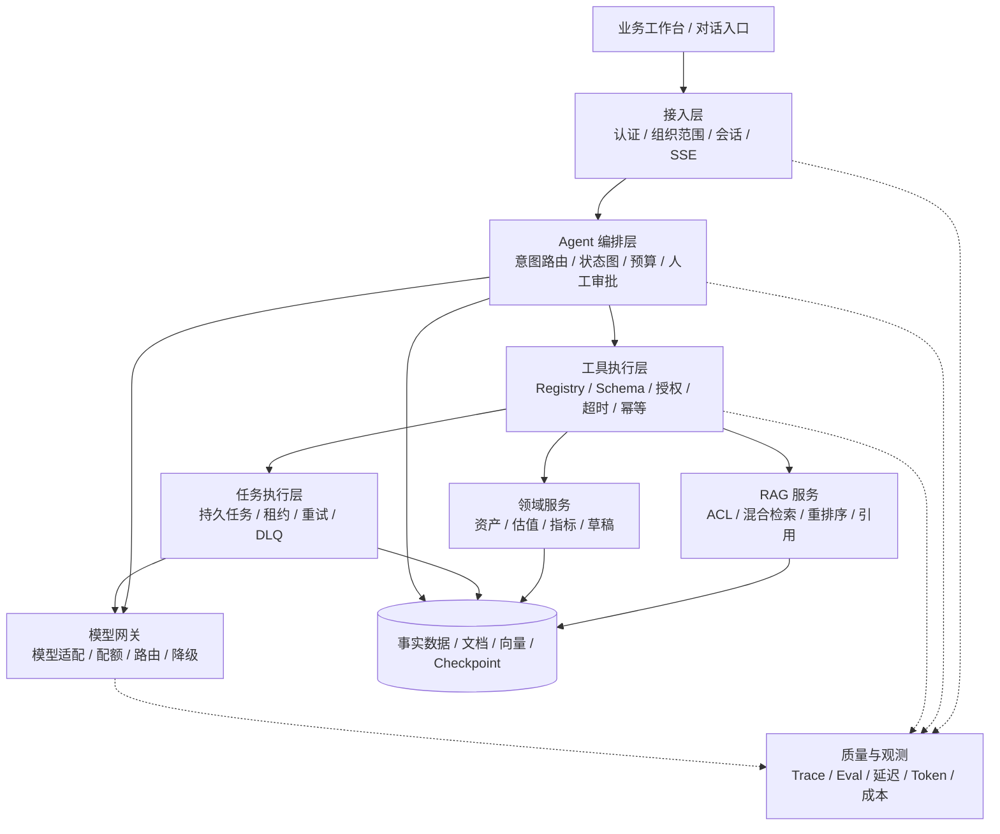

# 企业级 Agent 项目包装与面试答辩：成熟工程师表达版

> **2026-10-16 目标稿更新**：[简历文件](./Agent开发工程师简历_投递版.md)已改为完整目标项目情景，扩展能力与数字分别按“待落地 / 模拟”理解；实现存档见[当前实现版](./Agent开发工程师简历_当前实现存档.md)，开发顺序与验收见[目标研发路线](./Agent目标版量化指标与研发验收路线.md)。本文 2026-10-15 的改写说明保留作历史参考。

> 适用：2 年开发经验，Java / Python，目标 Agent 应用开发。更新：2026-10-15。  
> 配套文件：[简历投递版](./Agent开发工程师简历_投递版.md)；基础代码梳理与 48 道模拟题见[完整面试手册](./Agent开发求职简历与项目面试指南.md)。

> **本次补充**：国内招聘公开样本、并发 / 记忆 / 上下文 / 沙箱 / LangGraph / Trace，以及 RAG 分块、符号、跨文档、版本和量化实验，见[工程实战与量化面试指南](./Agent工程实战与量化面试指南.md)。投递正文已收敛为六条核心经历，设计成果单独呈现；没有把假设 QPS 或 Recall 写成实测结果。

这版将项目抽象为企业资产运营与决策场景，用责任范围、技术决策、失效模式和业务交付组织表达。简历正文聚焦已有工程实践，企业级扩展写成架构设计成果，不把设计方案描述为已完成的生产部署。年限与个人履历保持你的实际情况。

## 1. 这次搜索了哪些参考，如何借鉴

### 1.1 可读取的公开样本

本次搜索并阅读了以下材料。个人履历仅作为公开自述分析，未独立验证其任职与指标；匿名模板是写作示例，不是真实候选人的成绩单。

| 编号 | 材料 | 可借鉴的呈现方式 | 应用于你的材料 |
| --- | --- | --- | --- |
| S1 | Giorgi Giorgobiani 的 Senior AI Platform Engineer 公开项目履历 | 每个案例说明场景、本人决策和结果，并解释选型背后的约束 | 增加“我为什么这样拆分”和“我处理了哪类故障” |
| S2 | adongwanai 的 Agent / LLM 匿名简历与内容指南 | 将责任、关键机制、验证口径和结果压缩成可深入追问的项目条目 | 从功能列表改为责任与交付条目，指标另备口径 |
| S3 | AWS：Software Development Engineer, Agentic AI | 岗位描述涉及 Agent 记忆服务、可扩展性、效率与容错 | 将后端工程能力与 Agent 场景连接 |
| S4 | AWS：Agentic Data Engineer, Frontier AI Tooling | 强调 Agent 上下文的数据契约、数据质量、血缘与全周期交付 | 强化事实接入、字段口径和来源追溯 |
| S5 | AWS：Software Development Engineer, Agentic AI DevOps | 涉及架构、客户系统集成、故障处理与运营改进 | 在项目答辩中加入排障、取舍及演进优先级 |
| S6 | Harvard MCS 简历指南入口 | 将简历定位为精简的能力与经历摘要，并提供不同格式示例入口 | 简历与面试长文分开，正文控制信息密度 |

这里的岗位说明用于观察能力要求，不代表中国全部招聘市场，也不据此推导你的职级、薪资或录用概率。可访问说明不保证职位持续开放。来源地址见文末。

### 1.2 公开材料给本次改写的启发

以下是结合样本作出的写作判断：

1. **第一屏提供判断依据**：目标岗位、最强项目、负责范围和交付能力应该比普通自我评价更显眼。
2. **把技术名词接到机制**：不只写 RAG，而要说明文档怎么进入、权限在哪里校验、依据如何返回。
3. **展示关键决策**：解释哪些逻辑交给模型、哪些坚持程序计算，以及没有采用某方案的原因。
4. **结果包含异常行为**：正常可用之外，能否识别失败、释放资源和恢复任务，也体现工程深度。
5. **数字提供证据入口**：样本、基线、窗口和环境应能解释；没有测量时先写具体交付能力。

没有采用他人的任职、成本收益或性能数字。参考的是组织方式，正文为针对本项目重新撰写。

## 2. 定位升级：从功能开发者到核心链路负责人

### 2.1 推荐定位

**Agent 应用开发工程师｜企业 AI 工程化｜Java / Python**。

你的优势可以概括为：**能够把企业业务数据、权限、知识和领域规则组织成可交付的 AI 应用，并处理生成之外的工程问题。**

与年限相匹配的表达是：能够独立负责一条重要链路，对上下游边界有理解，并能解释关键取舍。简历不需要自封资深或架构师，也能呈现成熟度。

### 2.2 为什么不继续围绕“国企大屏”展开

对目标岗位而言，大屏属于业务交付的一部分。更通用的主线是：

```text
企业数据碎片化与人工决策成本
  → 组织权限和业务数据接入
  → 事实与知识上下文
  → 模型生成与领域工具
  → 结构化结果与人工复核
  → 异步执行、异常处理及质量反馈
```

这样既保留资产场景的真实性，也让面试官理解这套能力如何迁移到合同审查、企业知识助手和运营分析等相邻场景。迁移能力以架构复用解释，不宣称这些新行业均已交付。

### 2.3 简历开头的推荐表述

> 负责企业资产运营平台的 AI 核心链路与业务集成，围绕事实可信、知识检索、异步任务和流式交互建设可复用能力；能够从业务需求拆解出发，完成服务契约、模型接入与异常治理，推动 AI 能力进入可复核的业务流程。

这段表达传达三件事：你承担什么、你解决什么、你交付什么。

## 3. 项目背景的商业化表达

### 3.1 推荐背景：可用于简历或开场

企业资产运营涉及台账、合同、权属材料、制度和成交数据，多级组织的数据可见范围不同。业务人员需要跨系统收集信息，反复核对口径并编写分析材料。项目在既有资产管理流程上建设 AI 辅助决策层，将授权数据、知识证据和领域计算汇集到统一交互入口，支持资产咨询、材料识别、方案编制与运营分析。

### 3.2 面试进一步展开

建设这个系统需要同时处理三类约束：

- **数据约束**：信息不完整、附件非结构化、同名字段语义不一致。
- **组织约束**：监管、集团和下属公司使用同一入口，但不能共享全部数据。
- **决策约束**：建议可以由模型辅助，金额与审批不能依赖模型自由推断。

所以技术目标不是简单增加聊天框，而是为 AI 建立可靠的数据入口、受控的执行路径和可复核的输出。

### 3.3 个人职责怎么写

> 我负责 AI 应用与业务后端的核心链路，主要承担服务集成、上下文构建、知识检索、结构化方案和异步识别。架构上关注权限与推理解耦、计算与生成分工、交互与长任务分离；交付上处理流式中断、资料不足、任务重启和结果复核。

若确有独立决策和交付责任，可以使用“负责方案设计与核心实现”。团队共同决定的架构，讲清你承担的具体模块和推动的决策。

## 4. 重构项目表达：六条主线足够体现深度

### 4.1 服务边界与可复用能力

**简历表述**：负责业务服务与 AI 服务集成，将身份权限、事实供给与模型推理解耦，沉淀模型调用和领域 Provider，为问答、检索、估值和方案生成提供复用基础。

**面试展开**：

业务服务是资产和权限的权威来源；AI 服务消费经过授权的数据，负责模型与检索。Provider 抽象隔离资产、知识、估值来源，便于替换和测试；模型访问统一处理请求格式、超时和流式解析。

**取舍**：服务拆分增加调用链和错误映射成本，但避免将模型依赖和长耗时调用直接揉进所有业务接口。当前规模不急于引入复杂服务治理体系。

**交付效果**：不同 AI 入口可以复用部分事实与模型接入能力，权限规则继续由业务系统裁决。

### 4.2 数据可信与权限治理

**简历表述**：通过服务端授权校验、字段语义映射和 Grounded Context 建立可信事实入口，结合检索授权复核和来源返回，使模型分析可关联业务依据。

**面试展开**：

资产 ID 可以由用户选择，金额、组织归属和访问范围不能由用户自行声明为可信。读取权威数据后，明确字段含义、单位、缺失值和数据来源。知识片段在进入模型前经过授权复核。

**取舍**：输入边界控制能减少伪造路径，但不能证明模型永远不会被文档中的恶意指令影响；工具授权与写操作还需要独立约束。

**交付效果**：建立可解释的数据入口；资料不足与无权访问具有明确反馈。

### 4.3 流式交互与资源生命周期

**简历表述**：实现跨服务 SSE 流式输出与取消传播，统一增量、成功和失败事件，处理跨块解析、心跳与异常保留，使用户操作与上游资源释放形成闭环。

**面试展开**：

一次网络读取不等于一个完整事件，EOF 也不等于生成完成。前端跨块解析，后端传递业务终态；停止操作需要一路释放 Reader、生成器、待处理任务和 HTTP 连接。

**取舍**：不在输出一半后自动重试并拼接新答案，因为可能重复、冲突且多次计费。失败保留当前内容，由用户决定是否重新生成。

**交付效果**：渐进式阅读、可停止、可区分失败，避免将半成品标成成功。

### 4.4 结构化生成与领域计算

**简历表述**：整合资产事实、知识和估值参考，使用结构校验与来源规则约束方案；将关键金额交给确定性领域引擎，复用同一方案快照完成页面展示与 Word 导出。

**面试展开**：

Schema 约束结构，领域规则约束业务含义，证据约束来源，三者分工不同。估值通过 Decimal、有效样本和统一单位计算，模型只做解释。导出使用已生成结果，避免再生成第二份内容。

**取舍**：规则过滤不能覆盖所有语义错误，后续需将每项金额绑定单位、周期、来源及公式，并补逐结论证据检查。

**交付效果**：结果可以被程序消费、导出与复核；关键数值可复算。

### 4.5 异步任务与故障恢复

**简历表述**：将材料识别拆分为 API 与独立 Worker，结合队列、任务认领、锁校验、批次并发和有限重试，支持后台执行、进度查询与未完成任务恢复。

**面试展开**：

识别执行不应绑定浏览器连接。任务需要身份、输入、状态和结果，模型调用限制并发；瞬时失败退避重试，字段输出保留页码和证据。锁释放校验 owner，避免旧任务误删新锁。

**取舍**：当前具备局部防重和恢复，但不保证全链路 Exactly-once。多 Worker 需要逐任务租约、幂等提交与可靠消息进一步支撑。

**交付效果**：任务可在后台持续处理，用户可以稍后查看结果，部分失败有独立反馈。

### 4.6 质量与性能演进

**简历中的设计成果表述**：设计以任务成功率、关键事实正确率、引用准确率、TTFT 和每成功任务成本为核心的评测口径，将模型、检索和系统故障拆开定位，为后续 Agent 编排提供验收标准。

**面试展开**：

先建立基线，再比较更换 Embedding、加入 Reranker、裁剪上下文或使用不同模型的收益。错误分类至少区分事实缺失、检索缺失、引用不支持、业务计算错误和模型生成错误。

**取舍**：引入新组件可能提高质量，也增加延迟和运维成本。是否部署由评测决定，不能只因方案看起来完整就全部加入。

**交付效果**：这部分目前是方案产物；完成实验后用报告描述实际提升。

## 5. 更完整的商业级目标架构

本节将能力向企业级系统扩展，作为独立的架构设计案例。当前代码没有完成自主工具循环、LangGraph、MCP 或以下全套治理能力的部署。

### 5.1 架构分层



### 5.2 选择哪些能力交给 Agent

**适合自主探索**：根据问题选择检索方向、发现资料缺口、比较资产、组织分析步骤。

**适合固定流程**：权限判断、金额计算、指标聚合、文件版本、审批状态转换。

**需要批准的副作用**：创建并提交正式业务资料、推送外部平台、修改权威台账。

面试时可以这样说：

> 我的设计是把可变的任务规划与稳定的业务约束分离。Agent 决定下一步需要什么信息，执行层决定它是否有权、参数是否有效、预算是否允许以及结果怎样被验证。

### 5.3 状态图设计

```text
授权 → 意图识别 → 上下文构建 → 完整性检查
  → 规划 → 工具策略校验 → 执行 → 观察
  → 继续 / 生成 / 补充资料 / 失败
  → 结果校验 → 只读返回或人工审批
  → 重新校验权限与版本 → 幂等写入
```

状态至少包含：会话与执行标识、身份引用、授权版本、资产快照、证据、工具结果、待批准动作、已批准内容哈希、剩余预算和结束原因。

**LangGraph 的价值**：用明确状态和节点表示分支，为持久暂停与恢复提供基础。迁移现有 Provider，而非把所有业务函数重写进 Prompt。

**重要限制**：Checkpoint 不能消除工具重放。副作用发生但检查点尚未保存时崩溃，恢复仍可能再次执行；写入必须具备独立幂等语义。

### 5.4 工具治理

工具 Registry 不只是一个函数列表，还应记录：

| 内容 | 目的 |
| --- | --- |
| 输入 / 输出 Schema | 提供可验证契约 |
| 风险等级与读写属性 | 决定是否需要审批 |
| 当前身份与组织范围 | 执行时强制授权 |
| 版本与适用数据 | 处理契约变化及快照过期 |
| 超时与重试策略 | 限制故障扩散 |
| 幂等策略 | 避免重复副作用 |
| 结果体积上限 | 控制上下文膨胀 |
| 审计字段 | 定位谁在何时执行了什么 |

读取工具可以按策略重试；写入工具必须绑定明确业务动作。审批不能只批准“继续”，应批准具体参数和数据版本。

### 5.5 MCP 放在哪里

MCP 位于标准化能力接入边界，为外部或内部 Agent 提供受控工具与资源。模型的 Function Calling 负责提出调用请求，MCP Client / Server 负责协议连接与能力暴露，业务执行层继续负责授权和幂等。

它不替代 Agent 编排，也不自动提供数据库级访问控制。接入时固定协议与依赖版本，根据实际传输选择认证方式，验证凭据受众，避免跨服务无条件透传令牌。

### 5.6 RAG 面向商业场景的改造

1. 文档处理记录内容、分块、解析器和 Embedding 版本，保留标题、页码和业务对象关系。
2. 组织 ACL 在检索前缩小候选范围，返回模型前再进行权威复核。
3. 精确词法召回与语义召回并行，解决公司全称、资产编码、条款编号的检索需求。
4. 通过候选融合与重排序改善证据顺序，按 Token 预算组织上下文。
5. 结论绑定具体证据，缺少支持时返回不足，而不是只在答案末尾堆文档列表。
6. 新索引构建并验证后切换，避免先删旧向量后写新向量的查询空窗。

每一步都需要对照实验。混合检索和重排序是可选机制，不是对任意数据集的质量承诺。

### 5.7 任务、并发与成本治理

- **持久任务**：数据库保存任务与阶段状态；消息投递使用 Outbox 或可靠消息机制，处理状态与队列双写问题。
- **横向扩展**：按任务认领 lease，续租和超时回收；用 fencing token 或业务版本拒绝过期执行结果。
- **失败隔离**：重试只覆盖瞬时错误，加入 jitter、累计时限和 DLQ；不可恢复错误及时结束。
- **全局配额**：跨实例限制请求与 Token 消耗，按组织公平排队，避免单租户挤占全部预算。
- **上下文预算**：预留输出 Token，选取相关事实、证据和完整历史，摘要保留来源，不替代当前业务事实。
- **服务降级**：模型或知识库不可用时清晰表达范围；不把无证据生成当作完整业务分析。

### 5.8 观测与评测闭环

每次运行关联 request、run、tool call 和数据版本。把延迟拆成：排队、权限与事实查询、检索、重排序、模型首字、生成与校验。

评测至少覆盖：事实正确、依据支持、结构通过、权限正确、工具参数、终态和成本。离线保留集检查版本回归，线上采样收集失败，人工校准 Judge 的评分倾向。

简历可以把完成的这部分写为“定义评测口径与验收方案”；实际建设后再升级为“建立评测流水线”，取得测量后再写收益。

## 6. 把‘优化’写成专业成果

### 6.1 成果不只等于百分比

以下成果具有明确可观察行为，可以在没有性能数字时使用：

| 方向 | 可以写的结果 | 需要另外测量的结果 |
| --- | --- | --- |
| SSE | 边生成边阅读，停止可清理链路，异常保留文本 | 首字时间降低多少、费用减少多少 |
| 权限 | 服务端限制事实与文档范围 | 越权测试覆盖、漏洞检出与修复比例 |
| RAG | 可访问文档进入上下文，返回来源 | 召回率、引用准确率、业务正确率 |
| 方案 | 结构校验、资料不足提示、同快照导出 | 编制耗时、返工率、人工采纳率 |
| 识别 | 后台执行、进度查询、部分结果和恢复 | 字段准确率、P95、恢复成功率 |
| 估值 | 单位统一、样本门槛、结果可复算 | 与专家结论或真实成交的偏差 |

### 6.2 量化写法：填完才进入简历

```text
在[样本量与数据版本]、[模型版本]、[并发和资源条件]下，
针对[基线问题]采用[关键机制]，使[同口径指标]从[A]调整到[B]；
同时[质量或成本约束]保持在[实测范围]。
```

可以优先补四组数据：

1. **业务时间**：从人工收集资料到形成可复核草稿的耗时，按同一任务计时。
2. **知识质量**：固定问题集上的证据召回、事实正确和引用支持率。
3. **任务可靠性**：提交、执行中和结果保存阶段故障后的最终状态与重复副作用。
4. **交互成本**：TTFT、P95、Token 与每成功任务费用，包含重试和失败。

采用率和业务耗时依赖实际使用反馈。演示数据数量不能替代这些指标。

## 7. 面试官追问时，体现成熟度的八个回答

### 7.1 ‘你最关键的架构判断是什么？’

> 把事实与权限放在业务侧，把生成放在 AI 侧，把金额交给领域计算。这样每个模块有独立责任：数据错查事实来源，证据错查检索，数字错查计算，表达错查生成。拆分会增加接口，但减少所有问题都靠改 Prompt 处理的耦合。

### 7.2 ‘为什么不用模型把全部流程做完？’

> 因为模型生成的概率性与审批和金额的确定性要求不同。我允许模型提出分析步骤和建议，但可执行动作要通过应用策略，关键数值需要来源和公式。可自主的范围由错误成本和可验证性决定。

### 7.3 ‘你说可靠性，究竟做了什么？’

> 对流式请求，我区分业务完成与连接关闭，处理取消和资源清理；对识别任务，我做队列执行、状态认领、owner 校验和未完成任务恢复。它们是不同层面的机制，尚不能组合成严格 Exactly-once；下一步要处理消息双写和业务幂等。

### 7.4 ‘你会不会只是套了框架？’

> 框架能提供 HTTP、状态图或向量检索，但不能替我定义字段口径、组织权限、成功条件和重复副作用。我会举一个具体故障：比如半段 SSE 被误认成成功，或者旧任务误删新锁，然后说明定位和修复机制。

### 7.5 ‘为什么当前没有用 LangGraph？’

> 当前固定流程用领域服务已经能清楚表达。随着多步工具选择、人工暂停和跨进程恢复需求出现，状态图才带来明显价值。我已设计迁移边界：复用 Provider，用持久状态连接节点，优先验证恢复与幂等，而不是先把框架名加进技术栈。

### 7.6 ‘如果突然增加很多用户，你先改哪里？’

> 先按链路测量瓶颈。检查同步 SDK 是否阻塞事件循环、连接池和队列积压，再看模型 RPM / TPM 与输出长度。进程内 Semaphore 不能控制多实例总量，需要全局预算与公平排队；增加副本可能先放大供应商限流。

### 7.7 ‘怎么说明你的结果更好？’

> 用固定问题、权限身份、数据和模型做对照，把正确性、引用和延迟分开衡量。若加重排序只提高检索指标却让用户等待过久，未必值得全量开启。我会保留失败例和成本，按业务任务决定优化是否成立。

### 7.8 ‘你两年经验，成熟度体现在哪里？’

> 我能独立负责明确链路，知道哪些问题要程序保证，哪些交给模型辅助，也能讲清系统遇到故障后的行为。对未落地的全局可靠性和规模化能力，我会给出实施与验证方案，不把架构图当成交付结果。

## 8. 按岗位调整简历，不同时追所有方向

| 目标方向 | 第一屏主张 | 重点经历 | 作品补充 |
| --- | --- | --- | --- |
| Agent 应用开发 | 业务场景、工具边界与可交付结果 | 事实接入、方案、RAG、异步执行 | 有限工具循环和执行 trace |
| RAG / 知识工程 | 数据处理、授权、证据与质量 | 文档入库、检索、引用、领域语义 | 混合检索对照与错误分类 |
| AI 后端 / 平台 | 服务边界、生命周期与可靠性 | SSE、并发、任务、权限、契约 | 故障恢复和配额演示 |
| Java + AI 应用 | 业务能力与 AI 服务集成 | 领域规则、接口、组织范围、任务 | 用已有 Java 经历证明对应能力 |

训练、微调、分布式推理属于另一组能力。没有相应项目时不把 SFT、DPO、GRPO、GPU 集群当作技能标签；可以在学习路线单独呈现。

## 9. 一分钟项目介绍：更像承担交付责任的工程师

> 我负责的是企业资产运营平台的 AI 核心链路。业务上，资料分散在台账、合同和制度中，组织权限又比较复杂，业务人员需要反复找资料和编制方案。
>
> 我的主要工作是把业务事实、知识检索和模型生成打通，并处理交付约束。架构上把权威数据和模型推理解耦，金额计算独立到领域引擎；交互上实现端到端流式和取消，长任务通过独立 Worker 执行。
>
> 交付结果是，用户可以结合授权资产问答、查看知识依据、生成并导出结构化方案，识别任务也可以在后台运行。系统对资料不足、越权和中断有明确反馈。下一步会基于评测结果补工具循环和状态图恢复，而不是一开始叠加所有框架。

## 10. 当前能力与扩展能力如何一致表达

| 项目内容 | 简历用语 | 答辩用语 |
| --- | --- | --- |
| 已有对话与方案链路 | 负责 / 实现 / 交付 | 讲具体接口、异常与结果 |
| 本次形成的企业级架构 | 设计 / 定义 / 规划 | 讲约束、替代方案与验收 |
| 新建可运行演示 | 实现原型 / 验证 | 讲实验范围和未覆盖条件 |
| 完成固定数据评测 | 建立基线 / 对照验证 | 给样本、版本、指标和失败例 |
| 实际生产采用 | 上线 / 支撑 / 运营优化 | 说明使用范围、时间与数据来源 |

这样可以写得有力度，也能让简历、演示和现场回答保持一致。只需在材料中统一这个规则，不必在每个条目反复说明。

## 11. 参考来源与检索说明

访问日期：2026-10-15。未把搜索摘要当作完整履历，也未将匿名模板当作真实求职成绩。未复制公开个人联系方式。

**S1：公开个人履历与案例**  
Giorgi Giorgobiani — Senior AI Platform Engineer。已读取案例正文，借鉴其责任与决策的呈现方式；任职和数字均为作者自述。

`https://zuzuna54.github.io/`

**S2：中文 Agent 简历示例及指南**  
adongwanai / LLM-Resume-Template。已阅读 `resume-agent.tex`、`CONTENT-GUIDE.md` 与 README。该项目标注 CC BY 4.0；本材料对其内容组织方法作归纳，并为本项目独立改写正文，未采用示例履历与指标。

`https://github.com/adongwanai/LLM-Resume-Template`  
`https://github.com/adongwanai/LLM-Resume-Template/blob/main/resume-agent.tex`  
`https://github.com/adongwanai/LLM-Resume-Template/blob/main/CONTENT-GUIDE.md`  
`https://creativecommons.org/licenses/by/4.0/`

**S3：AWS Agentic AI 岗位**  
已通过 Amazon Jobs 官方查询接口读取对应岗位说明。

`https://www.amazon.jobs/en/jobs/10566213/software-development-engineer-agentic-ai`

**S4：AWS Agentic Data Engineer 岗位**

`https://www.amazon.jobs/en/jobs/10577269/agentic-data-engineer-frontier-ai-tooling`

**S5：AWS Agentic AI DevOps 岗位**

`https://www.amazon.jobs/en/jobs/10552775/software-development-engineer-agentic-ai-devops`

**S6：Harvard MCS 简历资源入口**  
已读取资源页简介与示例入口；未声称阅读其全部下载附件。

`https://careerservices.fas.harvard.edu/resources/harvard-college-guide-to-resumes-cover-letters/`

搜索引擎与部分站点返回访问限制；GitHub API、部分公开站点及官方岗位接口提供了可读取内容。这是一组定性参考，不是职位频次统计，也没有核验个人履历所带来的录用结果。
